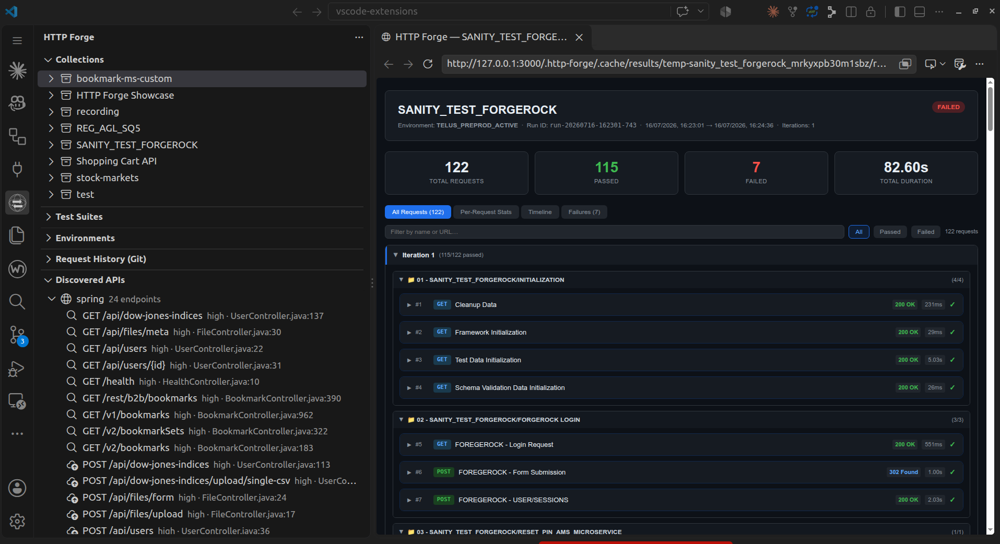

# HTTP Forge 🔨

**An AI-native, fully Postman-compatible API client for VS Code.**

Build, test, automate, and version REST, GraphQL, WebSocket/Socket.IO, and OpenAPI APIs in one local workspace — offline, Git-native, merge-friendly, and ready for AI agents.

Coming from Postman, Bruno, or Thunder Client? Import and run in under a minute.

[📖 Docs](docs/user-guide/index.md) • [🐛 Issues](https://github.com/hsl1230/http-forge/issues) • [📝 Changelog](CHANGELOG.md)

---

## The Lifecycle: Design or Discover → Generate → Edit → Run → Report → Fix ↺

| Stage | What happens |
|---|---|
| **Design** (manual or from intent) | Create an API by hand (import OpenAPI, build requests) or let AI design one from a plain-English intent | 
| **Discover** (from source code) | Scan a backend project for endpoints with provenance and confidence |
| **Generate** | Turn endpoints into requests, suites, flows, and workflow chains |
| **Edit** (CRUD · Import · Refine) | Create, read, update, delete requests; import Postman/OpenAPI; refine bodies, assertions, environments |
| **Run** | Execute requests, collections, folders, or suites (HTTP + WebSocket + Socket.IO) |
| **Report** | Inspect results, diagnose failures, generate HTML/JUnit/Markdown reports |
| **Fix ↺** | Heal assertions, regenerate stale suites, re-run until green |

The agent can drive every stage above; you can step in at any point. A pipeline stops at 'report.' HTTP Forge closes the loop — with AI in the driver's seat, a human in the loop, or both.

---

 

 
The extension, CLI, and MCP server share one workspace: design in the editor, automate in the terminal, and let your agent drive the full lifecycle — design, discover, generate, edit, run, report, fix, and re-run until green. Edits and fixes can come from the agent or from you; the cycle works either way.

---

## ⚡ Quickstart

1. `npm install -g @http-forge/cli && http-forge launch`
2. Open the HTTP Forge panel → click **+** → create a collection and request
3. Set method to **GET**, URL to `https://jsonplaceholder.typicode.com/posts/1`, hit **Send**

Full walkthrough (AI tests, collections, suites, CLI): [Getting Started](docs/user-guide/getting-started.md)

---

## 🎯 Use Cases

### 🧑‍💻 Explore & debug APIs
Build requests, inspect responses, and iterate fast — all without leaving VS Code. No account, no cloud, no subscription.

### 🤖 AI-assisted API testing — the full lifecycle, with you in control
Ask GitHub Copilot to generate tests, then shape them your way before the first run — adjust CRUD requests and chain them into flows, import an existing Postman collection or OpenAPI spec, refine assertions, bodies, and scripts. Then run, read the report, and when something fails, the agent proposes a fix and re-runs until green. **Every generated assertion is editable and every proposed fix is reviewable.** HTTP Forge ships a native, published MCP server — no build-from-source step.

### 🏗️ Design an API from an intent
Tell HTTP Forge "I need a shopping cart" and it designs the whole API — endpoints, DTOs, auth — as an OpenAPI spec, imports it as a collection, and generates the test suite, runnable flow, workflow chains, and docs in one reviewable package. Run it from the Command Palette (**HTTP Forge: Design an API from Intent (AI)**), from the CLI (`http-forge architect`), or via the `design_api_from_intent` MCP tool.

### 🔍 Discover your backend & keep tests in sync
The **Discovered APIs** tree view (**HTTP Forge: Discover APIs**) scans the workspace folder with six framework providers — Express, Nest, Fastify, AWS Lambda, Spring, and FastAPI — and lists every endpoint grouped by framework, with method, path, confidence, and source provenance. Right-click an endpoint (or a framework group) to act without leaving the editor:

- **Discover Request from Endpoint** — scaffold a working request from a discovered endpoint into any collection (auth header + path/query params + request body schema included).
- **Generate Test Suite from Discovered Endpoints** — create requests and a runnable suite (one node per endpoint asserting the discovered status) for a framework group or the whole scan.
- **Generate Collection from Discovered Endpoints** — create requests only (no suite) via CLI (`http-forge generate-collection --path <root> --collection <ref>`) or `http-forge discover --generate-collection <ref>`.

- **Check Discovery Drift** — compare project freshness against the last scan; when source has changed, offer to regenerate the derived suite while preserving your hand edits.

The same loop is available to agents via MCP: `create_request_from_endpoint`, `generate_test_suite`, `suggest_workflow`/`generate_workflow` for AUTH/CRUD chains, and `check_drift`/`propose_update` to detect stale generated suites while preserving hand edits.

### ✅ QA-gate your backend in one shot
Run **HTTP Forge: QA Check API (Discover, Generate, Run, Report)** from the Command Palette: pick a collection, point at a backend project and a running server (or dry-run the plan first), optionally add Copilot-written assertion suggestions, then review the per-endpoint report with one-click JSON save. Reruns reuse existing requests — nothing is duplicated unless the source changed. Same gate for agents via the `qa_api` MCP tool, and for CI via `http-forge qa` (exit codes 0 pass, 1 failures, 2 infra error, 3 drift).

### 🔄 Postman migration
Import your Postman v2.1 collection — all `pm.*` scripts, environments, and globals work unchanged. No rewriting, no learning curve.

### 🔐 Enterprise / secrets management
Connect to AWS Secrets Manager, Azure Key Vault, GCP Secret Manager, HashiCorp Vault, 1Password, or Doppler. Credentials never touch your filesystem.

### 🚀 CI/CD pipeline testing
Run `http-forge run my-collection --reporter junit` in any pipeline. Zero GUI dependencies, JUnit XML output, exit codes for pass/fail.

### 🧪 Contract testing with OpenAPI
Import your OpenAPI 3.0 spec, scaffold a full collection in one command, then validate every response against the spec — catch drift before it reaches production and reuse the same contract for docs, QA, and automation.

---

## 📸 Screenshots

<table width="100%">
  <tr>
    <th width="50%">The Loop</th>
    <th width="50%">Discovered APIs tree and HTML test report</th>
  </tr>
  <tr>
    <td width="50%"></td>
    <td width="50%"></td>
  </tr>
</table>

| Http Request | Test suite|
|---|---|
|  |  |

| Environment | Request Authorization|
|---|---|
|  |  |

| Script assistant | Schema definition |
|---|---|
|  |  |

---

## 🆚 vs Postman / Bruno / Thunder Client / Insomnia

| | HTTP Forge | Postman | Bruno | Thunder Client | Insomnia |
|---|---|---|---|---|---|
| Price | ✅ Free (MIT) | Free tier + paid tiers | ✅ Free | ✅ Free | Free tier + paid |
| No account required | ✅ | ❌ Mandatory | ✅ | ✅ | ❌ |
| Local / offline | ✅ | ❌ Cloud | ✅ | ✅ | ❌ |
| Git-friendly storage | ✅ | ❌ | ✅ | ❌ | ❌ |
| Native MCP server, ready to use | ✅ 60+ tools | ❌ | [待核实] | ❌ | ❌ |
| GitHub Copilot native | ✅ | ❌ Postbot | [待核实] | ❌ | ❌ |
| OpenAPI import + export | ✅ | ✅ import only | ❌ | ❌ | ✅ import only |
| TypeScript codegen | ✅ | ❌ | ❌ | ❌ | ❌ |
| Playwright integration | ✅ | ❌ | ❌ | ❌ | ❌ |
| Cloud secrets (AWS/Azure/GCP…) | ✅ | ❌ | ❌ | ❌ | ❌ |
| Design API from intent | ✅ | ❌ | ❌ | ❌ | ❌ |
| Native MCP server, ready to use | ✅ 60+ tools | ❌ | [待核实] | ❌ | ❌ |
| Closed lifecycle: design/discover → generate → edit → run → report → fix → re-run | ✅ | ❌ | ❌ | ❌ | ❌ |
| Human-in-the-loop edit & fix review | ✅ | N/A | N/A | N/A | N/A |
| GitHub Copilot native | ✅ | ❌ Postbot | [待核实] | ❌ | ❌ |

Your OpenAPI contract is not just for import or export — it can also be reused by your own team for documentation, testing, and downstream tooling.

---

## 🤖 AI & MCP
✅ Built-in MCP server — 60+ tools for GitHub Copilot, Claude, Cursor, Continue  
✅ Discovered APIs tree view — scan the workspace with all six framework providers (Express, Nest, Fastify, Lambda, Spring, FastAPI) and browse endpoints by framework with provenance  
✅ Design a full API from a plain-English intent — endpoints, DTOs, auth, tests, flow, and docs in one reviewable package (`HTTP Forge: Design an API from Intent (AI)`)  
✅ Workspace business context — drop Confluence exports, Jira summaries, or ADRs into `.http-forge/knowledge/**/*.md` and every AI analysis (assertions, env suggestions, coverage, collection enhancement) is grounded in them  
✅ Auto-generate request bodies and test scripts from natural language  
✅ Scan collections for hardcoded values → replace with `{{ENV_VAR}}`  
✅ Analyse test coverage against OpenAPI specs  
✅ Heal broken assertions after API changes  
✅ Open GitHub Copilot Chat with suite failure context to analyse failed requests faster  
✅ Generate negative/edge-case test scenarios  
✅ Full agent mode — AI drives the entire test lifecycle autonomously, with human review at every edit and fix step  
✅ Auto-generated `.http-forge/AGENTS.md` enables execution-only MCP mode for AI agents with workspace file access, reducing tool-list token overhead  
✅ **Two entry points** — design an API from plain-English intent, or discover endpoints from source code  
✅ **Full closed lifecycle** — design/discover, generate, edit (CRUD, import, refine), run, report, propose fixes, re-run until green  
✅ **Human-in-the-loop** — every generated assertion is editable and every agent-proposed fix is reviewable  

### 🔧 Request Builder
✅ All HTTP methods — GET, POST, PUT, PATCH, DELETE, HEAD, OPTIONS  
✅ Request bodies supported for all methods, including DELETE, GET, HEAD, and OPTIONS  
✅ Query params, headers, path variables with enable/disable toggles  
✅ JSON, form-data, raw text, binary, GraphQL body types  
✅ OAuth 2.0 (all 4 grant types + PKCE), Bearer, Basic, API Key  
✅ Pre/post scripts with full `pm.*` Postman API compatibility  
✅ IntelliSense for variables, filters, dynamic vars, and scripting API  
✅ Split/stack layout modes — view request and response side-by-side or stacked with resizable dividers  

### 🔌 WebSocket & Socket.IO
✅ Raw WebSocket and Socket.IO requests alongside HTTP in the same collection  
✅ Text and binary frames — Base64/hex encoding, JSON/XML/HTML formatting and beautify  
✅ Saved messages, Socket.IO event listeners, event args and acknowledgements  
✅ Frame inspector — search, direction filter, wrap, hexdump, diff, copy, and save  
✅ Handshake timeout, max message size, subprotocols, and reconnect settings  
✅ Headless raw WebSocket runs — collection, suite, CLI and MCP execution with `pm.test` assertions on the frame transcript

### 📁 Collections
✅ Git-friendly folder structure — one file per request  
✅ Discovered APIs tree view — endpoints from the workspace's backend (Express/Nest/Fastify/Lambda/Spring/FastAPI) grouped by framework, with confidence + source tooltips  
✅ Import Postman v2.1, export OpenAPI 3.0  
✅ Drag & drop, duplicate, file-watching auto-reload  
✅ Run collections or folders directly from the tree, including folders whose names contain `/`  
✅ Cross-collection test suites with iterations  
✅ Visual flow editor for suites — request, script, if/else, for, while, switch, block nodes  
✅ Fast node authoring — adding non-request nodes opens the editor immediately  
✅ Branch lifecycle controls — add/remove `else`, `elseif`, and `default` branches from the flow UI  
✅ Simple upfront request-count estimate with live total adjustment during flow execution  
✅ P50/P90/P95/P99 performance statistics  
✅ Self-contained HTML test reports  

### 🌍 Environments & Secrets
✅ Multiple environments with `{{variable}}` substitution  
✅ OS keychain integration (Windows, macOS, Linux)  
✅ Cloud secrets — AWS, Azure, GCP, HashiCorp Vault, 1Password, Doppler  
✅ `pm.environment.set()` persists across requests  

### 🖥️ CLI & CI/CD
✅ Headless collection runner — no VS Code needed  
✅ MCP server lifecycle management (`start`, `stop`, `status`)  
✅ JSON output for pipeline integration  
✅ JUnit XML reports  

---

## 🔄 Migrate from Postman

Export Postman collection (v2.1) → Import into HTTP Forge → Done. All `pm.*` scripts run unchanged.

| Postman feature | Status |
|---|---|
| Collections v2.1, environments, globals | ✅ Full import |
| `pm.test()`, `pm.expect()`, Chai assertions | ✅ Unchanged |
| `pm.environment`, `pm.globals`, `pm.collectionVariables` | ✅ Unchanged |
| `pm.sendRequest()`, `pm.setNextRequest()`, `pm.execution.skipRequest()` | ✅ Unchanged |
| CryptoJS, lodash, moment, uuid | ✅ Built-in |
| All body modes — raw, urlencoded, form-data, GraphQL, binary | ✅ Unchanged |
| WebSocket and Socket.IO requests | ✅ Request Tester; ✅ headless raw WebSocket runs (mixed with HTTP collections) |

---

## 👨‍👩‍👧‍👦 HTTP Forge Family

HTTP Forge is a family of components that share the same workspace model and work together across local development, AI workflows, and CI/CD.

| Component | Purpose | Best for |
|---|---|---|
| `http-forge` (VS Code extension) | Main UI for creating requests, running collections/suites, and managing environments | Daily API development inside VS Code |
| `@http-forge/cli` | Terminal and CI entry point (run, mcp, generate, schedule, etc.) | Pipelines, headless runs, scripting |
| `@http-forge/codegen` | Generates typed TypeScript API clients from collections | Type-safe API testing/client workflows |
| `@http-forge/playwright` | Runtime + shared types for generated Playwright clients | Executing generated clients in Playwright tests |
| `@http-forge/core` | Headless runtime engine and compatibility layer | Shared execution logic and Node automation |
| `http-forge-mcp` (HTTP Forge AI extension) | Companion extension that activates and configures MCP workflows for AI clients | Copilot/Claude/Cursor-driven API automation |

Typical flow: design and validate in the extension, automate with CLI/MCP, and generate typed clients for Playwright when needed.

---

## 📚 Documentation

- **[User Guide](docs/user-guide/index.md)** — start here, split by workflow
- **[Getting Started](docs/user-guide/getting-started.md)** — first-time setup in under 2 minutes
- **[Architecture](resources/architecture.png)** — how the extension, CLI, and MCP server share one workspace
- **[WebSocket Testing Guide](docs/websocket-examples.md)** — raw WebSocket and Socket.IO examples
- **[Postman Compatibility Reference](docs/user-guide/postman-compatibility.md)** — full `pm.*` matrix
- [CLI & CI/CD](docs/user-guide/cli-standalone.md)
- [MCP Server](docs/user-guide/mcp-server.md)
- [Secret Providers](docs/user-guide/secret-providers.md)
- [TypeScript Codegen](docs/user-guide/codegen.md)
- [Playwright Integration](docs/user-guide/playwright.md)
- [Configuration](docs/user-guide/configuration.md) — [full example](resources/http-forge.config.example.json)
- [Script API & Postman Compatibility](docs/postman-compatibility.md)
- [OpenAPI Round-Trip & API Design](docs/OPENAPI-SOLUTION.md)
- [Copilot Chat Guide](docs/COPILOT-CHAT-GUIDE.md)
---

## 📄 License

MIT. Free forever. No cloud account required. Core is free; team features may come later.

Enjoy HTTP Forge! 🔨✨