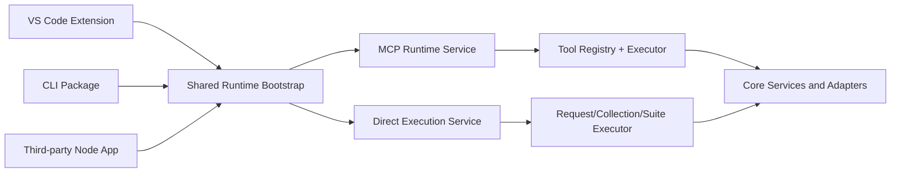

# Runtime Execution — Requirements & Solution (Historical)

> **Status / Current State**
>
> This document merges the historical requirements spec and implementation
> blueprint (2026-06-17), both of which have since been **implemented**.
> The shared-runtime architecture they describe is now shipping: one execution
> path serves the VS Code extension's in-process MCP executor, the standalone
> MCP server in `@http-forge/core` (`mcp-runtime.ts`), and the CLI. See
> `docs/user-guide/cli-standalone.md`, `docs/user-guide/mcp-server.md`, and
> [`README.md`](../README.md) for the current runtime surface.

---

# Runtime Execution Requirements

> **Status / Current State**
>
> This document is a **historical requirements spec** (2026-06-17) that has
> since been **implemented**. Its target capabilities are now shipping: the
> MCP server runs standalone via `@http-forge/core` (`mcp-runtime.ts`) and from
> the CLI (`http-forge mcp`), direct request/collection/suite execution is
> exposed through the CLI (`run`, `discover`, `generate-suite`, `architect`,
> etc.), and the extension's MCP executor runs in-process. See
> `docs/user-guide/cli-standalone.md`, `docs/user-guide/mcp-server.md`, and
> [`README.md`](../README.md) for the current runtime surface.

## Document Information

| Field | Value |
|---|---|
| Version | 1.0 |
| Last Updated | 2026-06-17 |
| Status | ✅ Implemented (see banner above) |
| Audience | HTTP Forge maintainers, contributors, integrators |

---

## 1. Executive Summary

This document defines the requirements for expanding HTTP Forge runtime usage beyond VS Code-hosted MCP execution.

The target capability set is:

1. Run MCP server from terminal (without VS Code host process).
2. Run request/collection/suite directly from terminal.
3. Embed HTTP Forge runtime in third-party Node.js apps.
4. Expose direct request/collection/suite APIs that do not require MCP server startup.
5. Preserve behavior correctness for typed template/filter arguments (including filter argument variable deserialization).

---

## 2. Problem Statement

Current implementation is extension-centric and MCP runtime wiring is effectively coupled to extension bootstrap/runtime lifecycle.

This creates these gaps:

1. No first-class terminal CLI for MCP server lifecycle.
2. No first-class terminal commands for request/collection/suite execution.
3. No embeddable Node runtime API for external integrators.
4. No direct execution API surface for consumers that do not want MCP protocol overhead.
5. Typed variable marker values can fail in filter argument variable lookup unless deserialized before coercion.

---

## 3. Goals and Non-Goals

### 3.1 Goals

1. Provide one shared runtime path used by VS Code, CLI, and embeddable APIs.
2. Keep request execution behavior parity across all entry points.
3. Provide stable command/API contracts for external adoption.
4. Keep compatibility with existing collection/suite/script behaviors.
5. Ensure typed marker values resolve correctly in filter argument variable lookup.

### 3.2 Non-Goals

1. Redesigning Request Tester UI.
2. Changing existing extension command IDs/workflows.
3. Rewriting core execution engines.
4. Introducing behavior that weakens security controls.

---

## 4. Functional Requirements

### 4.1 CLI Requirements

| ID | Requirement | Priority |
|---|---|---|
| FR-CLI-1 | System SHALL provide a dedicated CLI package with executable entry point. | Must |
| FR-CLI-2 | CLI SHALL support managed `mcp-server` lifecycle subcommands (`start`, `stop`, `status`) from terminal. | Must |
| FR-CLI-3 | CLI SHALL support `run-request` subcommand. | Must |
| FR-CLI-4 | CLI SHALL support `run-collection` subcommand. | Must |
| FR-CLI-5 | CLI SHALL support `run-suite` subcommand. | Must |
| FR-CLI-6 | CLI SHALL support `--output json|table`. | Must |
| FR-CLI-7 | CLI SHALL return non-zero exit code on execution failure. | Must |

### 4.2 Embeddable Runtime Requirements

| ID | Requirement | Priority |
|---|---|---|
| FR-EMBED-1 | Core SHALL expose `createMcpRuntime(options)` for Node consumers. | Must |
| FR-EMBED-2 | Runtime handle SHALL expose `start()`, `stop()`, `isRunning()`, `getPort()`. | Must |
| FR-EMBED-3 | Runtime handle SHALL expose `executeTool(name, args)` for in-process tool execution. | Should |
| FR-EMBED-4 | Runtime SHALL use host-agnostic adapters and shared DI bootstrap path. | Must |

### 4.3 Direct Execution API Requirements

| ID | Requirement | Priority |
|---|---|---|
| FR-DIRECT-1 | Core SHALL expose `runRequest(options)` with no MCP server requirement. | Must |
| FR-DIRECT-2 | Core SHALL expose `runCollection(options)` with no MCP server requirement. | Must |
| FR-DIRECT-3 | Core SHALL expose `runSuite(options)` with no MCP server requirement. | Must |
| FR-DIRECT-4 | Direct API options SHALL support environment and variables injection. | Must |
| FR-DIRECT-5 | Direct API options SHALL support iterations/stopOnError/delay where applicable. | Must |
| FR-DIRECT-6 | Direct APIs SHALL return typed results (no process exits in library mode). | Must |

### 4.4 Compatibility and Behavior Requirements

| ID | Requirement | Priority |
|---|---|---|
| FR-COMPAT-1 | Extension MCP behavior SHALL remain backward compatible. | Must |
| FR-COMPAT-2 | Report URI behavior SHALL remain usable from non-extension paths. | Must |
| FR-COMPAT-3 | Request/collection/suite execution semantics SHALL match existing executor flow. | Must |

---

## 5. Non-Functional Requirements

| ID | Requirement | Priority |
|---|---|---|
| NFR-1 | Shared runtime implementation SHALL avoid logic duplication across entry points. | Must |
| NFR-2 | API contracts SHALL be deterministic and strongly typed. | Must |
| NFR-3 | CLI output SHALL be machine-readable in JSON mode. | Must |
| NFR-4 | CLI output SHALL be human-readable in table mode. | Should |
| NFR-5 | Security-sensitive behavior SHALL not weaken existing protections. | Must |

---

## 6. Acceptance Criteria

### 6.1 Runtime/CLI

1. Starting MCP server from CLI succeeds without VS Code process.
2. `run-request` executes a saved request and prints result.
3. `run-collection` executes collection and supports iterations.
4. `run-suite` executes suite with stop-on-error and delay options.
5. JSON output is valid JSON and includes summary/result details.
6. Failed command returns non-zero exit code.

### 6.2 Embeddable API

1. Third-party Node app can construct runtime via exported API.
2. Runtime can start/stop and report running state/port.
3. Runtime can execute tools/direct API calls in process.

### 6.3 Direct APIs

1. `runRequest` works without MCP startup.
2. `runCollection` works without MCP startup.
3. `runSuite` works without MCP startup.
4. Returned object shape is typed and does not terminate process.

---

## 7. Requirement Traceability Matrix

| Requirement ID | Primary Implementation Surface | Verification |
|---|---|---|
| FR-CLI-1..7 | Planned CLI package entry points and command handlers | CLI integration tests + manual terminal runs |
| FR-EMBED-1..4 | Core runtime factory and lifecycle handle | Node embedding smoke test |
| FR-DIRECT-1..6 | Core direct execution exported APIs | API unit/integration tests |
| FR-COMPAT-1..3 | Existing extension MCP wiring and shared executors | Extension compile + parity checks |

---

## 8. Related Artifacts

- Session planning baseline: `/memories/session/plan.md`
- Existing extension MCP wiring: `http-forge/src/infrastructure/mcp/`
- Core bootstrap and contracts: `http-forge.core/src/di/`, `http-forge.core/src/types/`

---

## 9. Open Decisions

1. Whether direct API surface is marked experimental in first release.
2. Whether CLI is released as standalone npm package or workspace-local first.
3. Whether result output schema is versioned from v1 for long-term stability.

---

# Runtime Execution Solution

> **Status / Current State**
>
> This document is a **historical implementation blueprint** (2026-06-17) that
> has since been **implemented**. The shared-runtime architecture it describes
> is now shipping: one execution path serves the VS Code extension's in-process
> MCP executor, the standalone MCP server in `@http-forge/core`
> (`mcp-runtime.ts`), and the CLI. See `docs/user-guide/cli-standalone.md`,
> `docs/user-guide/mcp-server.md`, and [`README.md`](../README.md).

## Document Information

| Field | Value |
|---|---|
| Version | 1.0 |
| Last Updated | 2026-06-17 |
| Status | ✅ Implemented (see banner above) |
| Depends On | RUNTIME-EXECUTION-REQUIREMENTS.md |

---

## 1. Solution Summary

This solution introduces a shared runtime architecture that supports three consumption modes from one execution path:

1. VS Code extension MCP integration backed by core runtime APIs.
2. Terminal CLI (`mcp-server start|stop|status`, `run-request`, `run-collection`, `run-suite`).
3. Embeddable + direct library APIs (`createMcpRuntime`, `runRequest`, `runCollection`, `runSuite`).

The design keeps behavior parity by centralizing execution logic in reusable runtime services rather than duplicating extension-specific code.

---

## 2. Architecture Overview



### Core Principles

1. Single source of truth for execution flow.
2. Host-specific concerns only at adapter/bootstrap boundary.
3. Contract-first exports for runtime and direct APIs.
4. Backward compatibility for extension command/runtime behavior.

---

## 3. Component Design

### 3.1 Shared Runtime Bootstrap

Responsibilities:

1. Build core service container with platform adapters.
2. Configure workspace path, stores, watcher, notification, browser abstractions.
3. Expose resolved runtime dependencies needed by MCP/direct execution services.

Notes:

1. Existing extension bootstrap remains a valid host implementation.
2. CLI and external Node consumers use Node-native adapter implementations.

### 3.2 Embeddable MCP Runtime API

Proposed surface:

```typescript
export interface McpRuntimeOptions {
  workspaceFolder: string;
  port?: number;
  host?: string;
  configOverrides?: Record<string, unknown>;
}

export interface McpRuntimeHandle {
  start(): Promise<void>;
  stop(): Promise<void>;
  isRunning(): boolean;
  getPort(): number;
  executeTool(name: string, args?: Record<string, unknown>): Promise<unknown>;
}

export function createMcpRuntime(options: McpRuntimeOptions): Promise<McpRuntimeHandle>;
```

Implementation mapping:

1. Reuse MCP tool registry behavior and executor semantics.
2. Keep report URI generation and rewrite logic compatible with current outputs.
3. Preserve include/options behavior for request/collection/suite tools.

### 3.3 Direct Execution APIs (No MCP)

Proposed surface:

```typescript
export interface RunRequestOptions {
  workspaceFolder: string;
  collectionId: string;
  requestId: string;
  environment?: string;
  variables?: Record<string, unknown>;
  headers?: Record<string, string>;
  query?: Record<string, string>;
  body?: string;
  include?: string[];
}

export interface RunCollectionOptions {
  workspaceFolder: string;
  collectionId: string;
  environment?: string;
  variables?: Record<string, unknown>;
  iterations?: number;
  stopOnError?: boolean;
  delay?: number;
  include?: string[];
}

export interface RunSuiteOptions {
  workspaceFolder: string;
  suiteId: string;
  environment?: string;
  variables?: Record<string, unknown>;
  iterations?: number;
  stopOnError?: boolean;
  delay?: number;
  requestFilter?: string[];
  include?: string[];
}

export function runRequest(options: RunRequestOptions): Promise<unknown>;
export function runCollection(options: RunCollectionOptions): Promise<unknown>;
export function runSuite(options: RunSuiteOptions): Promise<unknown>;
```

Implementation mapping:

1. Delegate to shared execution services used by MCP tool path.
2. Return typed result objects and throw typed errors.
3. Keep response shapes aligned with MCP output payload semantics.

### 3.4 CLI Package

Commands:

1. `http-forge mcp-server start [--port] [--host]`
2. `http-forge mcp-server stop`
3. `http-forge mcp-server status`
4. `http-forge run-request --collection <id> --request <id> [options]`
5. `http-forge run-collection --collection <id> [options]`
6. `http-forge run-suite --suite <id> [options]`

Common options:

1. `--workspace <path>`
2. `--environment <name>`
3. `--output json|table`
4. `--include <value>` (repeatable)

Exit code model:

1. `0` success.
2. `1` runtime/config/validation failure.
3. `2` command usage/argument error.

---

## 4. Requirement-to-Solution Mapping

| Requirement Group | Solution Component |
|---|---|
| FR-CLI-* | CLI package command layer over shared runtime/direct APIs |
| FR-EMBED-* | Exported `createMcpRuntime` with lifecycle handle |
| FR-DIRECT-* | Exported direct execution functions |
| FR-COMPAT-* | Reuse current executor flow and output/report semantics |

---

## 5. Implementation Plan (Execution Order)

1. Define public runtime/direct API contracts in core exports.
2. Introduce Node host adapters and bootstrap for non-extension use.
3. Implement embeddable MCP runtime factory on shared services.
4. Implement direct execution APIs.
5. Create separate CLI package and wire subcommands to step 3 and 4 APIs.
6. Add tests for parity and filter argument correctness.
7. Update changelog and usage docs.

---

## 6. Verification Strategy

### 6.1 Parity Verification

1. Compare extension MCP tool outputs with CLI/runtime outputs for same inputs.
2. Verify include flags and report URI behavior consistency.
3. Verify collection iterations behavior parity with suite behavior.

### 6.2 API Verification

1. Validate runtime lifecycle methods (`start`, `stop`, `isRunning`, `getPort`).
2. Validate direct APIs execute without MCP server startup.
3. Validate library mode never calls `process.exit`.

---

## 7. Risks and Mitigations

| Risk | Impact | Mitigation |
|---|---|---|
| Drift between extension and CLI logic | Behavioral inconsistency | Force CLI to call shared runtime/direct APIs only |
| Contract churn for early adopters | Integration breakage | Publish stable v1 contracts and changelog notes |
| Host adapter differences | Runtime errors in non-VSCode host | Add adapter conformance tests and smoke tests |
| Output shape mismatch | Tooling breakage | Maintain schema parity and snapshot tests |

---

## 8. Related Files

- Extension MCP integration point: `http-forge/src/extension.ts`
- Extension composition root: `http-forge/src/infrastructure/services/service-bootstrap.ts`
- Core bootstrap/contracts: `http-forge.core/src/di/core-bootstrap.ts`, `http-forge.core/src/types/platform.ts`
- Requirements source: `http-forge/docs/archive/RUNTIME-EXECUTION-HISTORY.md`
