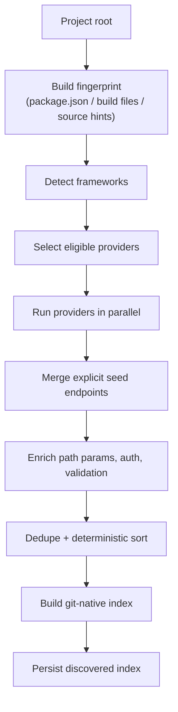
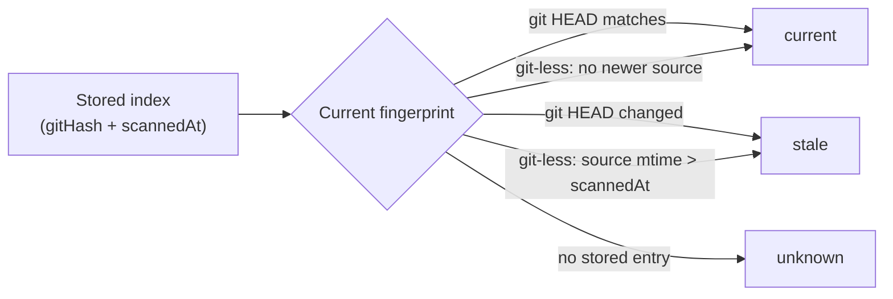

# Discovering API endpoints from source code with zero OpenAPI specs

OpenAPI is great when it exists.

It often doesn't. Or it exists but hasn't been regenerated since the last three sprints. Or it covers the public API but not the internal services. Or it's maintained by hand and is quietly wrong in exactly the places you need it most.

For a testing tool, that's a problem: if you can't enumerate the endpoints, you can't generate tests for them. You're back to hand-authoring requests in Postman, which is where collections go to die.

This is how HTTP Forge discovers endpoints directly from source code — six framework providers, deterministic output, golden fixtures, and drift detection — with no OpenAPI spec required.

## Why source code beats a spec

An OpenAPI spec is a *derived* artifact. Source code is the source of truth.

If discovery reads the source, three useful things follow:

1. **No spec maintenance tax.** There's nothing to regenerate before you can test.
2. **Provenance.** Every endpoint can point back to `file:line` — framework, confidence, and the source that produced it.
3. **Drift detection.** You can fingerprint the source (git hash + mtime) and know when a stored index is stale.

The tradeoff is parser complexity and the risk of false positives. A wrong endpoint that breaks `run_request` is worse than a missing endpoint. The design rule I used: **incomplete coverage is fine; false positives are not.** Unknown patterns get `confidence: 'low'` rather than a confident guess.

## The six providers

One class per framework, all implementing the same `ApiDiscoveryProvider` contract:

```ts
export interface ApiDiscoveryProvider {
  readonly id: string;
  readonly framework: ApiFramework;

  supports(fingerprint: FrameworkFingerprint): ProviderSupport;

  discover(
    context: DiscoveryContext,
    fingerprint: FrameworkFingerprint
  ): Promise<DiscoveryResult>;

  clearCache?(projectRoot?: string): void;
}
```

Adding a framework means adding a provider and registering it — never editing the orchestrator. That Open/Closed boundary is why the list can grow without destabilizing the existing parsers.

**Express** — detects the `express` dependency, scans TS/JS source files, and analyzes route registrations (`app.get`, `router.post`, mounts, middleware chains). It emits path params, request body schema hints, and provenance.

**NestJS** — reads decorators on controllers (`@Controller`, `@Get`, `@Post`, `@Body`, `@Param`) and resolves the controller prefix plus method path.

**Fastify** — follows `fastify.get/post/...` registrations and inline `register()` plugins with prefixes. (Known limitation: a variable plugin instance passed to `register()` isn't traversed.)

**AWS Lambda** — finds handler exports and serverless-style route definitions, mapping function names to HTTP methods and paths.

**Spring** — parses Java with `java-parser`'s AST, with a regex fallback for patterns the AST misses. It handles `@RestController`, `@RequestMapping`, `@GetMapping`, path variables, and Pydantic-like model → JSON Schema generation for request bodies.

**FastAPI** — a pure-JS, balance-aware line walker. No Python runtime, no Python parser dependency. It handles `FastAPI()`/`APIRouter(prefix=...)`, `@app.<method>` decorators, `{param}` paths, `Path/Query/Header/Cookie/Body/File/Form` parameters, Pydantic `BaseModel` → JSON Schema, and project-wide `include_router` prefix resolution (including `import ... as` aliases and tag merge).

## The pipeline

Discovery isn't just "run the parser." The orchestrator does fingerprinting, framework detection, parallel provider execution, seed merging, enrichment, dedupe, and deterministic sorting.



A few details that matter:

- **Language-aware hints.** Framework detection scans only relevant extensions — TS/JS for the Node providers, `.java` for Spring, `.py` for FastAPI. Without this, `app.get(` in a Python decorator would falsely trigger the Express hint.
- **Empty source sets fall back.** If the TS/JS collector finds nothing, the orchestrator leaves `fingerprint.sourceFiles` unset so Spring and FastAPI can run their own Java/Python collectors. Otherwise a standalone controller file would never be scanned.
- **Seed merge.** If you have an explicit seed (a hand-curated endpoint list), it merges by `METHOD + resolvedPath` and keeps unmatched seed endpoints with a warning.
- **Deterministic IDs.** Endpoint IDs are derived from method, path, and source location — not from timestamps or random values.

## Determinism is a feature, not a nicety

Sorted output is what makes discovery diffable:

```ts
function compareEndpoints(a: DiscoveredApi, b: DiscoveredApi): number {
  const methodOrder =
    (SORT_METHOD_ORDER[a.method.toUpperCase()] ?? 99) -
    (SORT_METHOD_ORDER[b.method.toUpperCase()] ?? 99);
  if (methodOrder !== 0) return methodOrder;

  const pathA = a.resolvedPath ?? a.pathExpression;
  const pathB = b.resolvedPath ?? b.pathExpression;
  if (pathA !== pathB) return pathA < pathB ? -1 : 1;

  if (a.source.filePath !== b.source.filePath) {
    return a.source.filePath < b.source.filePath ? -1 : 1;
  }
  return a.source.line - b.source.line;
}
```

Ordering is method ascending (GET, POST, PUT, PATCH, DELETE, HEAD, OPTIONS), then resolved path, then source file, then line. If two scans of unchanged code produce different output, every downstream diff becomes noise.

There are no timestamps inside endpoint records. The only time-like fields live in the explicit freshness metadata.

## Golden fixtures: TDD for parsers

Parser code is easy to write and hard to trust. The anchor is a set of small, real backend projects under `test-fixtures/`:

- `express-app`
- `nestjs-app`
- `fastify-app`
- `lambda-app`
- `spring-app`
- `fastapi-app`

Each fixture is self-contained and deterministic: 5–8 endpoints, at least one `:id` path param, one POST-with-body, one DELETE, no dynamic route registration, no generated code. Each ships an `expected.endpoints.golden.json`.

The convention is deliberately strict:

1. Sort endpoints identically (method, path, file, line).
2. Strip volatile fields (`id`, `projectRoot`, `projectName`, timestamps).
3. Compare relative source paths, never absolute workspace paths.
4. Deep-equal against the golden file.

Golden files are **locked**. The test starts red; the provider is written until it's green. Regeneration happens only for a deliberate, reviewed change — and the reason goes in the commit message. You never weaken a golden assertion to make a wrong output pass.

That last rule is the whole game. Without it, "fixing the fixture" becomes the default response to a parser bug, and the suite stops meaning anything.

## Drift detection: knowing when the index is stale

A discovered index is a snapshot. The question is: when is it no longer true?

The drift engine computes a freshness fingerprint:

```ts
export interface ProjectFreshness {
  gitHash?: string;
  /** Max mtime (ms) of any scanned source file under the project root. */
  maxSourceMtime: number;
}
```

- In a git work tree, freshness is keyed on `git rev-parse HEAD`.
- In a git-less workspace, it degrades to mtime: a source file newer than the stored `scannedAt` marks the project stale.
- No git and no mtime signal means `unknown` — never a false claim of freshness.



The engine also implements a 3-way diff and a resolver for regenerated artifacts. The rule is **regenerate, don't patch**: re-derive the artifact from source, then surface which hunks are AI-generated vs user-edited. Only `ai_generated` regions are regenerable; hand-edited assertions survive regeneration.

That's the part that keeps generated suites from becoming disposable.

## What it doesn't do (yet)

Being honest about coverage is part of the trust model:

- **Fastify** variable plugin instances passed to `register()` aren't traversed — routes can be missed or emitted without the mount prefix.
- **FastAPI** f-string/expression decorator paths are emitted with `confidence: 'low'`.
- **No native .NET or Django providers.** For those, import an OpenAPI spec (Swashbuckle / `drf-spectacular`) or let an AI agent infer endpoints from the workspace.
- **Dynamic route registration** from config or a database can't be discovered by static analysis. That's a fundamental limit — but it's not a dead end: a **custom seed loader module** can supply those endpoints at discovery time.

### Custom seed loader: the escape hatch for dynamic routes

Set `customSeedLoaderModulePath` and the orchestrator loads your module and merges its endpoints with the statically discovered ones:

```ts
// seed-loader.ts (project-local)
import type { DiscoveredApi } from '@http-forge/core';

export function loadSeedManifestEndpoints(projectRoot: string): DiscoveredApi[] {
  const routes = JSON.parse(readFileSync(`${projectRoot}/routes.json`, 'utf8'));
  return routes.map((route: any) => ({
    id: '', // filled in by the orchestrator
    method: route.method,
    pathExpression: route.path,
    resolvedPath: route.path,
    framework: 'unknown',
    confidence: 0.8,
    source: { filePath: 'routes.json', line: 1 },
    // ...headers, params, body schema as needed
  }));
}
```

The loader is resolved relative to the project root (or absolute), called with `(projectRoot, discoveryContext)`, and may return either a bare `DiscoveredApi[]` or `{ endpoints, warnings }`. Matched endpoints merge with the auto-discovered ones; unmatched seed endpoints are kept with a warning rather than silently dropped. Failures surface as `seed-loader-failed` warnings instead of aborting the scan.

## Try it

Discovery runs in the CLI, the VS Code extension, and the MCP server:

```bash
http-forge discover --path ./backend --output table
http-forge generate-suite --path ./backend --collection "my-api" --dry-run
```

Or from an agent, via `create_request_from_endpoint` and `generate_test_suite`.

- **Getting started:** [docs/user-guide/getting-started.md](../user-guide/getting-started.md)
- **CLI reference:** https://github.com/hsl1230/http-forge.cli/blob/main/docs/cli-reference.md
- **HTTP Forge for VS Code:** https://marketplace.visualstudio.com/items?itemName=henry-huang.http-forge

If you're building your own discovery layer, the two ideas worth stealing are the **locked golden fixtures** and the **deterministic ordering rule**. They turn a parser from "seems to work" into something you can refactor without fear.
