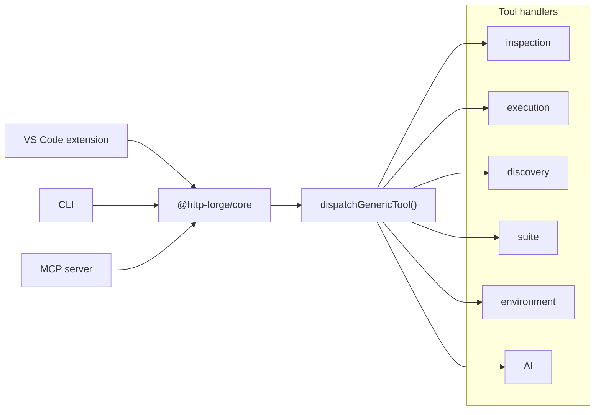

# How I built an MCP server that lets AI agents run my API tests

I built HTTP Forge because I was tired of maintaining Postman collections by hand. Every time a route changed, a DTO gained a field, or an auth header moved, the collection went stale — and nobody trusted it enough to keep it updated.

The second problem was more interesting: I wanted an AI agent to be able to drive the whole lifecycle — discover endpoints, generate tests, run them, read the report, diagnose failures, and fix stale assertions. Not just "write me a test" in a chat window, but actually operate the tool.

That meant building an MCP server.

This is the story of how it works, what I got wrong, and the transcript of an agent running a real test lifecycle.

## Why MCP?

The Model Context Protocol (MCP) is a standard way to expose tools to an AI agent. Instead of every agent vendor inventing its own plugin format, the agent discovers a server, lists its tools, and calls them with JSON arguments.

For a testing tool, that's a natural fit. A test run is a sequence of well-defined operations:

1. List collections.
2. Run a request or suite.
3. Read the results.
4. Explain a failure.
5. Rewrite a stale assertion.
6. Re-run.

Each of those is a tool. The agent doesn't need to know how HTTP Forge stores collections on disk — it just needs a stable contract.

## The architecture

HTTP Forge has three consumers: a VS Code extension, a CLI, and an MCP server. They all share the same core engine, `@http-forge/core`, which is now open source (MIT).

The important constraint: **core cannot import `vscode`**. That forced a ports-and-adapters design. The core defines interfaces; the extension and CLI inject platform services (file system, workspace state, secret storage).

The MCP layer sits on top of core like this:



The dispatcher is deliberately small. Each tool lives in a handler module, and the registry assembles them:

```ts
const ALL_HANDLERS: McpToolHandler[] = [
  ...inspectionHandlers,
  ...executionHandlers,
  ...collectionHandlers,
  ...requestHandlers,
  ...discoveryHandlers,
  ...suiteHandlers,
  ...aiHandlers,
];

function buildRegistry(): Map<GenericToolName, McpToolHandler> {
  const registry = new Map();
  for (const handler of ALL_HANDLERS) {
    for (const name of handler.toolNames) registry.set(name, handler);
  }
  return registry;
}
```

Adding a tool means adding a handler — not editing the dispatcher. That Open/Closed boundary kept the MCP layer maintainable as it grew past 60 tools.

## The tool surface

The MCP server exposes tools in a few groups:

- **Inspection** — `list_collections`, `list_requests`, `get_request`, `get_run_summary`, `get_failed_requests`.
- **Execution** — `run_request`, `run_folder`, `run_collection`, `run_suite`.
- **Discovery** — `create_request_from_endpoint`, `generate_test_suite`, `suggest_workflow`, `check_drift`.
- **AI** — `suggest_assertions`, `explain_failure`, `heal_assertions`, `generate_scenarios`.
- **Suites and environments** — create/update nodes, select environments, set variables.

Two design choices matter a lot:

**1. Execution is synchronous by default, async on request.** A small suite returns its result inline. A large suite can be started with `async: true`, returning a `runId` that the agent polls with `get_run_status`.

**2. Outputs are bounded.** MCP responses go into an LLM context window. The server truncates large bodies and offers `include` fields (`perRequest`, `failedOnly`, `consoleOutput`) so the agent asks for detail only when it needs it.

## A real lifecycle transcript

Here's what an agent actually does with the server. I've trimmed the outputs for readability.

### Step 1 — Discover endpoints from source

```json
{
  "tool": "create_request_from_endpoint",
  "arguments": {
    "path": "./backend",
    "collection": "user-service",
    "endpointId": "POST /users"
  }
}
```

The agent gets back a created request plus provenance — framework, source file, confidence. No OpenAPI spec required.

### Step 2 — Generate a suite

```json
{
  "tool": "generate_test_suite",
  "arguments": {
    "path": "./backend",
    "collection": "user-service",
    "suiteName": "smoke-tests"
  }
}
```

The generator creates one request node per endpoint and asserts the discovered status code. Generated nodes carry `ai_generated: true` and `derived_from: <endpointId>` so drift detection can find them later.

### Step 3 — Run it

```json
{
  "tool": "run_suite",
  "arguments": {
    "suite": "smoke-tests",
    "environment": "staging",
    "include": ["failedOnly"]
  }
}
```

```json
{
  "runId": "run-20261030-141501",
  "status": "completed",
  "allPassed": false,
  "failedRequests": [
    {
      "name": "Create User",
      "status": 500,
      "assertions": [
        { "name": "Status is 201", "passed": false, "actual": 500 }
      ]
    }
  ]
}
```

### Step 4 — Diagnose

```json
{
  "tool": "explain_failure",
  "arguments": {
    "runId": "run-20261030-141501",
    "request": "Create User"
  }
}
```

The response includes the full request, the response, every assertion result, any script errors, and a plain-English diagnosis. In this case: the staging database was down, not a test bug.

### Step 5 — Heal a stale assertion

Now suppose the API legitimately changed: `Create User` used to return `201`, and now returns `200`. The test is stale, not the server.

The agent calls:

```json
{
  "tool": "heal_assertions",
  "arguments": {
    "collection": "user-service",
    "request": "Create User",
    "runId": "run-20261030-141501"
  }
}
```

The server returns the current script and the last observed response:

```json
{
  "task": {
    "currentScript": "pm.test('Status is 201', () => pm.response.to.have.status(201));",
    "lastResponse": { "status": 200, "body": { "id": "u1", "name": "Alice" } },
    "instructions": [
      "Rewrite the script to match the observed response",
      "Call set_request_script with the new script"
    ]
  }
}
```

The agent then rewrites and saves:

```json
{
  "tool": "set_request_script",
  "arguments": {
    "collection": "user-service",
    "request": "Create User",
    "phase": "post-response",
    "script": "pm.test('Status is 2xx', () => pm.expect(pm.response.code).to.be.oneOf([200, 201]));\npm.test('Returns an id', () => pm.expect(pm.response.json()).to.have.property('id'));"
  }
}
```

And re-runs the suite. Green.

## Assertion healing: why it's safe

The scary part of AI-driven testing is an agent silently weakening your assertions to make tests pass. I designed `heal_assertions` to avoid that:

- It's **advisory**. The tool returns a task describing what to compare; the *agent* writes the new script.
- The agent must explicitly call `set_request_script` to persist it. Every change is a normal script edit in the collection, visible in git.
- The prompt instructs the agent to keep valid assertions and only fix stale ones.
- There's no "auto-confirm" path. A human can review the diff like any other code change.

The goal is not "agent makes tests green." It's "agent proposes a fix you can review in the same way you'd review a PR."

## Lessons learned

**Error messages are prompts.** When an agent calls `run_request` with a collection name that doesn't exist, a bare `not found` is useless. Returning the available names — `Available: user-service, billing-service` — lets the model self-correct in one turn. I rewrote most error paths for this.

**Tool names must survive real IDs.** MCP tool names have provider length limits, and HTTP Forge IDs embed human-readable names. I added deterministic short hashing for long IDs, with readable slugs where possible. The model picks tools by description, so short names don't hurt discovery.

**Determinism matters.** Discovery output is sorted by method, path, and file. No timestamps inside endpoint records. When the agent diffs two scans, noise kills the signal.

**Token budget is a feature.** Async runs, `include` filters, and body truncation aren't optimizations — they're what make the server usable with a 200k-token context.

**Keep core UI-free.** Because MCP, CLI, and the extension share the engine, a bug fixed in one is fixed everywhere. The `vscode`-free boundary is the reason that works.

## Try it

If you want to play with the same lifecycle without wiring up a backend:

```bash
npm install -g @http-forge/cli
http-forge launch --examples
```

That clones a sample workspace with pre-built requests, environments, and suites, then opens it in VS Code. You can run a suite, break an assertion on purpose, and watch the explain/heal flow.

- **HTTP Forge for VS Code:** https://marketplace.visualstudio.com/items?itemName=henry-huang.http-forge
- **Open-source core:** https://github.com/hsl1230/http-forge.core

If you're building your own MCP server, the two things I'd steal are the per-tool registry and the "errors as prompts" habit. They made the difference between a demo and something an agent can actually use.
