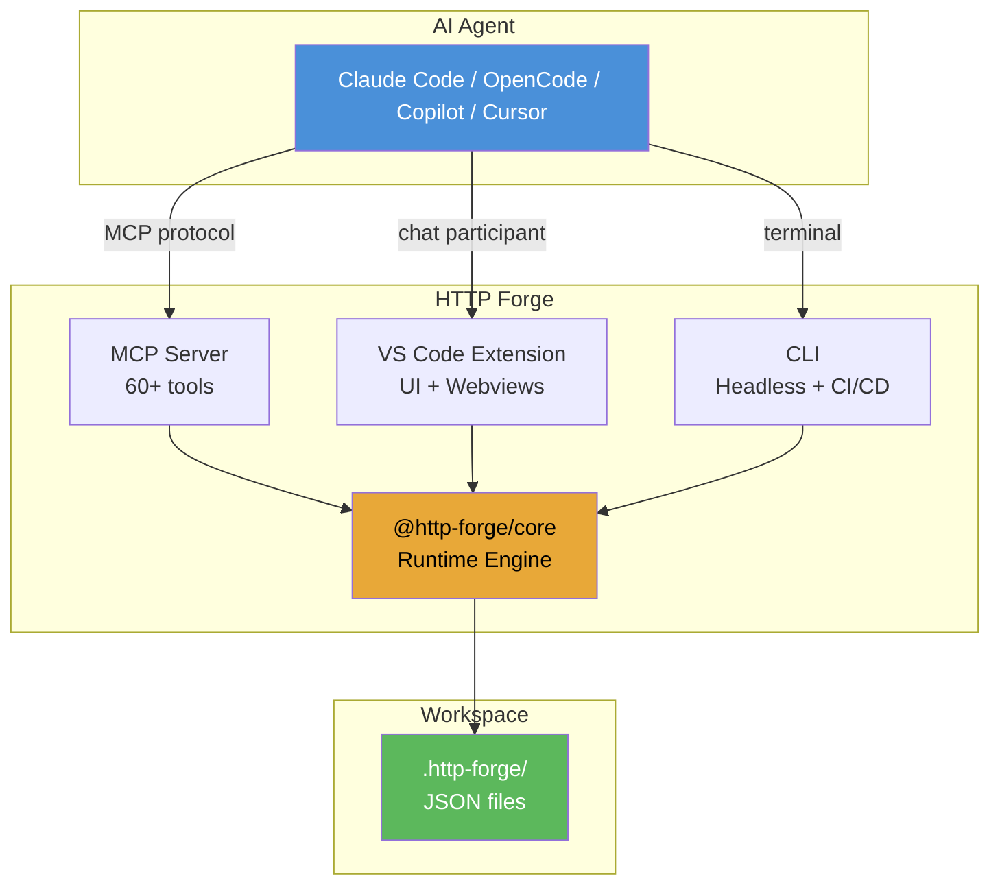
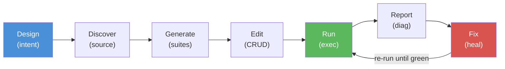
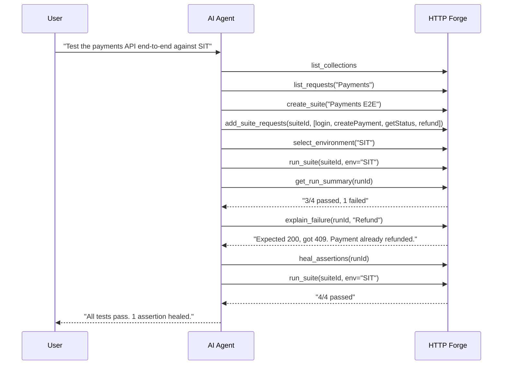
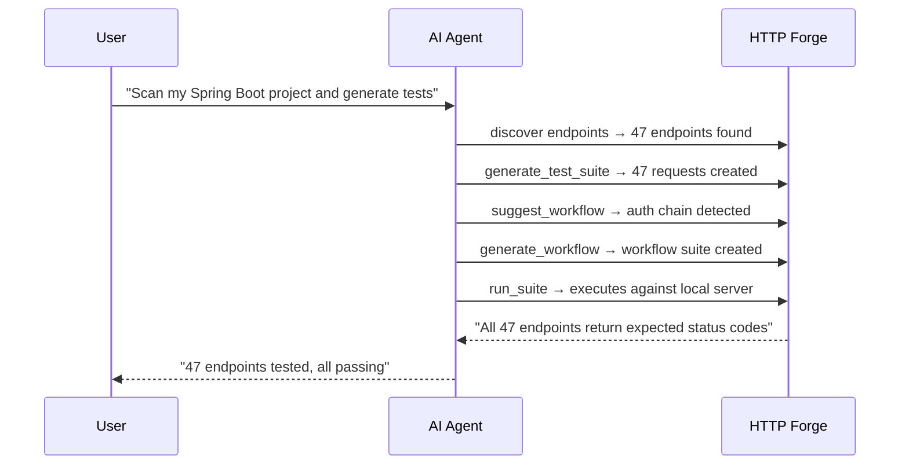
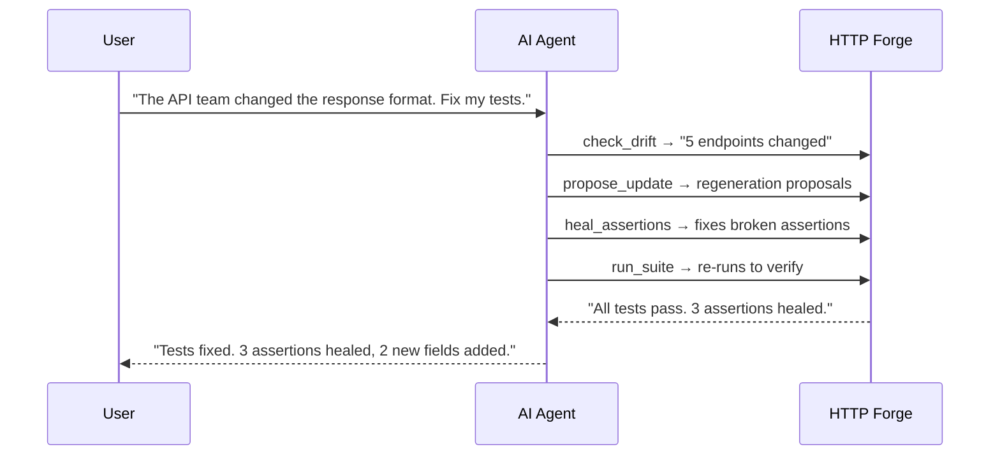
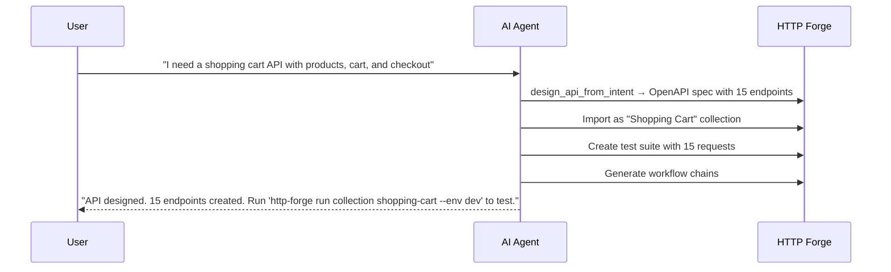
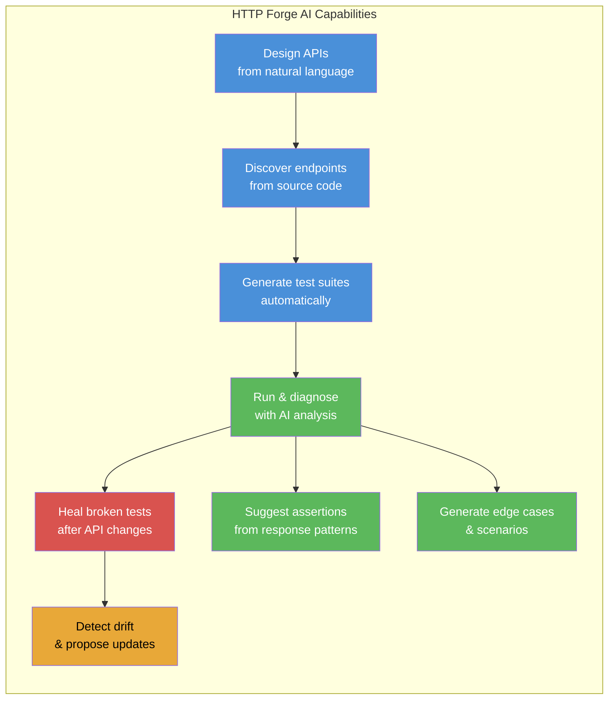
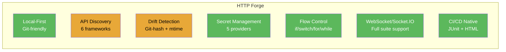
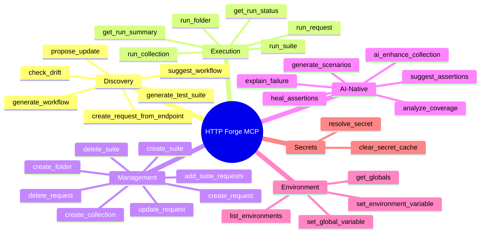

# HTTP Forge — AI-Powered API Testing: A Developer's Guide

> **Audience:** Developers and QA engineers who want to leverage AI agents (Claude Code, OpenCode, GitHub Copilot, Cursor) for API testing.
> **Purpose:** Show what HTTP Forge can achieve when combined with AI agents, and how to get started.

---

## What is HTTP Forge?

HTTP Forge is an **AI-native API testing platform** that runs entirely locally. It provides:

- A **VS Code extension** for interactive API testing (Request Tester, Test Suites, Collections)
- A **CLI** (`http-forge`) for CI/CD, headless execution, and scripting
- An **MCP server** with 60+ tools that AI agents invoke to drive the entire API testing lifecycle
- A **runtime engine** (`@http-forge/core`) shared across all three

Everything is stored as plain JSON files in a `.http-forge/` workspace folder — Git-friendly, merge-friendly, no cloud account required.

---

## Architecture



- **Core engine**: Runtime, collections, environments, test suites, secrets, MCP handlers
- **Extension**: VS Code UI (Request Tester, Test Suites tree, webviews, Copilot integration)
- **CLI**: Headless execution, CI/CD, MCP server mode
- **Workspace**: `.http-forge/` folder with collections, environments, suites, knowledge files

---

## The AI Agent Loop

HTTP Forge is built around a **Design → Discover → Generate → Edit → Run → Report → Fix** loop. AI agents can drive every stage:



The agent can drive every stage above; you can step in at any point. A pipeline stops at "report." HTTP Forge closes the loop — with AI in the driver's seat, a human in the loop, or both.

---

## What AI Agents Can Do

### 1. Design APIs from Natural Language

**Tool:** `design_api_from_intent` (MCP) / `http-forge architect` (CLI)

Tell the agent what you want in plain English:

> "Design a REST API for a shopping cart with products, cart, and checkout"

The agent will:
- Generate an OpenAPI 3.0 spec from the intent
- Import it as a collection with all endpoints
- Create test suites with assertions
- Generate runnable flow files and workflow chains
- Produce documentation

### 2. Discover Endpoints from Source Code

**Tools:** `create_request_from_endpoint`, `generate_test_suite` (MCP) / `http-forge discover` (CLI)

Point the agent at a backend project:

> "Scan the Spring Boot project at /path/to/project and create test requests"

The agent will:
- Scan source code with 6 framework providers (Express, Nest, Fastify, AWS Lambda, Spring, FastAPI)
- Extract endpoints with method, path, parameters, and schemas
- Create requests in a collection with provenance (framework, source file, confidence)
- Generate test suites asserting discovered status codes
- Detect workflow chains (auth → CRUD) automatically

### 3. Author and Manage Collections

**MCP Tools:** `create_collection`, `create_folder`, `create_request`, `update_request`, `delete_request`, `set_request_script`, `reorder_collection_items`

The agent can build entire collections from scratch:

> "Create a 'Payments API' collection with a Checkout folder containing CreateOrder, GetOrder, and Refund requests. Add pre-request scripts for auth token injection."

### 4. Build and Manage Test Suites

**MCP Tools:** `create_suite`, `add_suite_requests`, `add_suite_node`, `update_suite_node`, `remove_suite_node`, `move_suite_node`, `duplicate_suite`, `delete_suite`

The agent can compose complex test flows:

> "Create a 'Checkout Regression' suite that runs Login, CreateOrder, GetOrder, and Refund in sequence. Add an if-node to check the order status before refunding."

Suites support control-flow nodes: `request`, `script`, `if/elseif/else`, `switch/case/default`, `for`, `while`, `block`.

### 5. Run and Diagnose

**MCP Tools:** `run_request`, `run_folder`, `run_collection`, `run_suite`, `get_run_summary`, `get_failed_requests`, `explain_failure`, `suggest_assertions`

The agent can execute and diagnose:

> "Run the Checkout Regression suite against SIT and explain any failures"

The agent will:
- Execute the suite against the selected environment
- Get the run summary with pass/fail counts
- Analyze failed requests with business context
- Suggest assertions based on response patterns
- Heal broken assertions automatically

### 6. Heal and Maintain

**MCP Tools:** `heal_assertions`, `check_drift`, `propose_update`, `generate_scenarios`

The agent can maintain test suites over time:

> "Check if the API has drifted since the last scan and propose updates"

- Detect drift between discovered endpoints and stored requests
- Propose updates while preserving user customizations (3-way merge)
- Heal assertions that broke due to API changes
- Generate edge-case scenarios (null inputs, boundary values, etc.)

### 7. Environment & Variable Management

**MCP Tools:** `list_environments`, `get_environment_variables`, `select_environment`, `create_environment`, `set_environment_variable`, `set_global_variable`, `get_globals`

The agent can manage environments:

> "Create a SIT environment with base_url, auth_token, and client_id variables"

### 8. Secret Management

HTTP Forge supports universal JSON secret bundling:

- Store secrets in GCP Secret Manager, AWS Secrets Manager, Azure Key Vault, 1Password, or HashiCorp Vault
- Reference secrets as `{{secret:gcp/alias/path}}` in any field
- Automatic TTL caching (5-minute default) for performance
- Secrets are resolved at request time, never stored in the repo

### 9. AI-Native Features

| Feature | Description |
|---|---|
| **suggest_assertions** | AI generates test assertions from response patterns |
| **explain_failure** | AI diagnoses failures with business context |
| **heal_assertions** | AI fixes broken assertions after API changes |
| **generate_scenarios** | AI creates edge-case test scenarios |
| **analyze_coverage** | AI analyzes test coverage gaps |
| **ai_enhance_collection** | AI improves collection quality (naming, descriptions) |
| **ai_suggest_env_vars** | AI suggests environment variables from request patterns |

---

## MCP Server Setup

### For Claude Code / OpenCode

Add to your MCP configuration:

```json
{
  "mcpServers": {
    "http-forge": {
      "command": "http-forge",
      "args": ["mcp", "--workspace", "/path/to/your/project"]
    }
  }
}
```

### For GitHub Copilot

HTTP Forge auto-registers as a VS Code MCP server. The Copilot Chat participant `@http-forge` provides guided workflows.

### For Cursor / other MCP clients

Same as above — point the MCP client at `http-forge mcp --workspace <path>`.

---

## CLI Quick Reference

```bash
# Launch the UI
http-forge launch

# Run a collection
http-forge run collection "Auth Flow" --env staging

# Run a test suite
http-forge run suite "Regression" --env prod --stop-on-error --exit-code

# Run all suites
http-forge run suite --all-suites --env prod

# Run suites in a folder
http-forge run suite --suite-folder "initialization" --env prod

# Discover endpoints from source
http-forge discover --path /path/to/project --framework spring

# Generate test suite from discovered endpoints
http-forge generate-suite --path /path/to/project --collection my-api --dry-run

# Design an API from intent
http-forge architect "A shopping cart API" --apply

# Check for drift
http-forge drift --path /path/to/project
```

---

## AI Agent Workflows

### Workflow 1: "Test this API end-to-end"



### Workflow 2: "Generate tests from my Spring Boot project"



### Workflow 3: "My tests are failing after the API changed"



### Workflow 4: "Design an API from a feature request"



---

## Key Differentiators

### AI-Native: The Core Advantage

HTTP Forge is not just "AI-compatible" — it is **AI-native**. Every feature is designed to be driven by AI agents through 60+ MCP tools, GitHub Copilot integration, and CLI automation. Postman, Bruno, Insomnia, Thunder Client, and Hoppscotch all have varying levels of AI integration — but HTTP Forge's AI capabilities are local-first, MCP-driven, and cover the entire testing lifecycle from design to maintenance.



#### What AI agents can do with HTTP Forge

| AI Capability | HTTP Forge | Postman | Bruno | Insomnia | Thunder Client | Hoppscotch |
|---|---|---|---|---|---|---|
| **Design API from intent** | `design_api_from_intent` — OpenAPI spec + collection + suites + flows from plain English | Postman AI (Agent Mode) | None | None | None | None |
| **Discover endpoints from source** | Scans 6 frameworks with provenance & confidence | None | None | None | None | None |
| **Generate test suites** | Auto-creates suites with assertions from discovered endpoints | AI test generation (contract, load, unit, integration, E2E) | AI generates tests from descriptions | None | AI generates tests from prompts | None |
| **Detect workflow chains** | Auth → CRUD chains auto-detected from endpoint analysis | None | None | None | None | None |
| **Drift detection** | Git-hash + mtime freshness; proposes updates preserving user edits | None | None | None | None | None |
| **Heal assertions** | AI fixes broken assertions after API schema changes | Agent Mode (diagnoses & fixes) | None | None | Run & fix failures | None |
| **Generate scenarios** | AI creates edge-case tests (null, boundary, invalid inputs) | None | None | None | None | None |
| **Suggest assertions** | AI analyzes response patterns and proposes assertions | Postman AI (basic) | AI generates tests from descriptions | Insomnia AI (basic) | None | None |
| **Explain failures** | AI diagnoses failures with business context | Agent Mode (diagnoses root cause) | None | Insomnia AI (basic) | None | None |
| **Enhance collections** | AI improves naming, descriptions, organization | Agent Mode (edits collections) | AI generates docs/scripts/tests | None | None | None |
| **Suggest env vars** | AI detects repeated values and suggests environment variables | None | None | None | None | None |
| **Coverage analysis** | AI identifies untested endpoints and gaps | None | None | None | None | None |
| **MCP tools** | 60+ tools for full CRUD, execution, diagnosis, maintenance | 100+ tools (Minimal/Code/Full/Learn/Context Graph) | Agent Skills (MCP-compatible) | MCP Client (test MCP servers) | 12 MCP tools (create, run, fix) | 53 MCP tools (collection/request/env CRUD, execution, code/docs gen) |
| **Copilot Chat participant** | `@http-forge` guided workflows in VS Code | Postman CLI skills for Claude Code/Cursor/Codex | Agent Skills for Cursor/Copilot/Claude | None | MCP for Copilot/Cursor/Claude | None |
| **AI Chat Sidebar** | Via Copilot / MCP | Agent Mode (in-app) | Native AI chat sidebar (BYOK) | None | None | AI Assistant (Enterprise) |
| **Inline autocomplete** | Monaco IntelliSense for script globals | None | Ghost-text in scripts/tests | None | None | None |
| **AI mock generation** | None | None | None | AI Mock Server from natural language | None | None |
| **Agent Skills** | None | Postman CLI skills | Bruno Skills (reusable workflows) | None | None | AI Skills (/ menu) |

> **Note:** Postman has the most mature AI integration (Agent Mode, AI Test Generation with 100+ MCP tools, CLI skills for Claude Code/Cursor/Codex). Bruno has native AI (BYOK chat sidebar, inline autocomplete, generate scripts/tests/docs, Agent Skills for coding agents). Insomnia has AI mock generation, AI commit suggestions, MCP Client, and Koh CLI (agent-friendly). Thunder Client has an MCP Server (12 tools) for AI agents. Hoppscotch has an AI Assistant (Enterprise) and an MCP Server (53 tools). HTTP Forge's AI capabilities are local-first, MCP-driven, and cover the entire testing lifecycle — design, discovery, generation, execution, diagnosis, healing, drift detection, and maintenance.

#### The key insight

Postman has the most mature AI integration — Agent Mode, AI Test Generation, MCP Server, and CLI skills for coding agents. Bruno has native AI with BYOK (chat sidebar, inline autocomplete, generate scripts/tests/docs, Agent Skills). Insomnia has AI mock generation, AI commit suggestions, and an MCP Client. Thunder Client has an MCP Server with 12 tools. Hoppscotch has an AI Assistant (Enterprise) and an MCP Server.

What sets HTTP Forge apart is the **breadth and depth** of AI integration across the entire lifecycle — from designing APIs from natural language, to discovering endpoints from source code, to healing broken tests after API changes, to detecting drift and proposing updates. All AI capabilities are local-first, MCP-driven, and every change is a Git-tracked file. The 60+ MCP tools provide full CRUD, execution, diagnosis, and maintenance — not just test generation.

### Other Differentiators



| Feature | HTTP Forge | Postman | Bruno | Insomnia | Thunder Client | Hoppscotch |
|---|---|---|---|---|---|---|
| **Local-first** | All data in Git, no cloud | Cloud-dependent | Local | Cloud-dependent | Local | Cloud-dependent |
| **AI-native** | 60+ MCP tools, Copilot, local-first | Agent Mode, MCP Server, CLI skills | Native AI (BYOK chat, autocomplete) | AI mock gen, MCP Client, Koh CLI | MCP Server (12 tools) | AI Assistant (Enterprise), MCP Server |
| **API discovery** | Scan source code (6 frameworks) | None | None | None | None | None |
| **Drift detection** | Git-hash + mtime freshness | None | None | None | None | None |
| **Secret management** | GCP/AWS/Azure/1Password/Vault | Cloud vault | None | Cloud vault | None | None |
| **Flow control** | if/switch/for/while/block nodes | Limited | None | None | None | None |
| **WebSocket/Socket.IO** | Full support in suites | Limited | None | Limited | None | Limited |
| **CI/CD** | Native CLI with JUnit/HTML reports | Newman (separate) | CLI | Inso (separate) | None | None |

---

## Getting Started

### 1. Install

```bash
# VS Code extension
code --install-extension henry-huang.http-forge

# CLI
npm install -g @http-forge/cli
```

### 2. Initialize workspace

```bash
mkdir my-api-tests && cd my-api-tests
http-forge launch --examples  # or open in VS Code
```

### 3. Connect AI agent

Add to your MCP config (Claude Code, OpenCode, Cursor):

```json
{
  "mcpServers": {
    "http-forge": {
      "command": "http-forge",
      "args": ["mcp", "--workspace", "."]
    }
  }
}
```

### 4. Start testing

```
"Discover APIs in /path/to/my-backend and generate tests"
```

---

## MCP Tool Categories (60+ tools)



---

## Resources

- **User Guide**: `docs/user-guide/` (getting-started, test-suites, mcp-server, secret-providers, etc.)
- **CLI Reference**: `http-forge.cli/docs/cli-reference.md`
- **Core Reference**: `http-forge.core/docs/api/core-reference.md`
- **Developer Docs**: `http-forge/docs/developer/`
- **MCP Management Tools**: `http-forge.core/docs/developer/MCP_MANAGEMENT_TOOLS.md`
