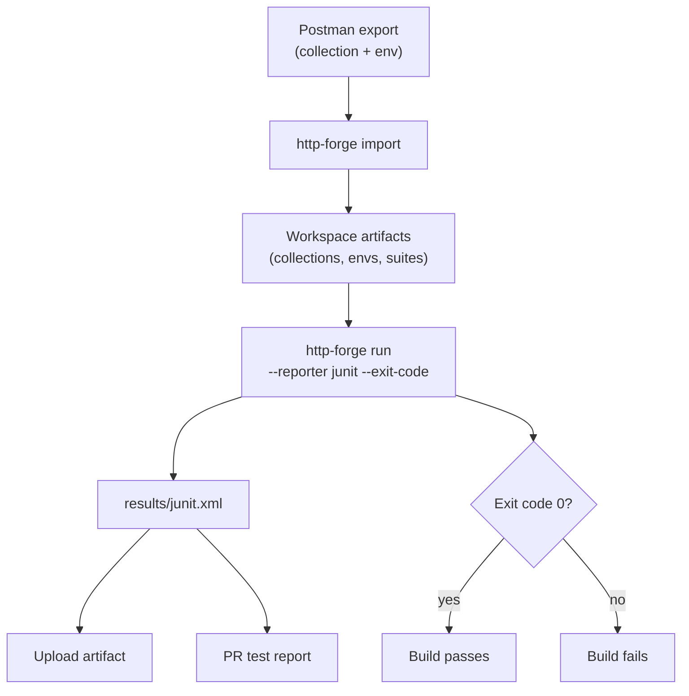

# How to run Postman collections in CI without Postman

You have a Postman collection. It works on your machine. Now you want it to run on every pull request without installing Postman, paying for a cloud runner, or asking everyone to learn Newman.

This is a practical guide to doing exactly that with the HTTP Forge CLI:

1. Import the Postman collection and environment.
2. Run the collection headlessly.
3. Emit a JUnit report.
4. Wire it into GitHub Actions.

No GUI required after the import.

## Why not just use Newman?

Newman is the obvious answer, and it works. But it has a few sharp edges in CI:

- It's a separate runtime from the rest of your tooling.
- Environment/collection files are passed as CLI paths, which makes multi-environment setups awkward.
- Reports are decent but JUnit output needs extra configuration.
- There's no built-in way to re-derive the collection when the API changes.

HTTP Forge takes a different approach: it imports the Postman collection into a workspace-native format (collections, environments, and suites on disk), then runs that workspace headlessly. The import is a one-time migration step; after that you're running HTTP Forge artifacts, not Postman files.

If you want to keep Postman as the authoring tool, that's fine too — you can re-import on each CI run. Both patterns are shown below.

## Step 1 — Import the collection

Export your collection from Postman as **Collection v2.x** JSON, then:

```bash
npm install -g @http-forge/cli

http-forge import collection \
  --postman ./MyApi.postman_collection.json \
  --name "My API"
```

That creates a collection in the current workspace. To target a specific workspace:

```bash
http-forge import collection \
  --postman ./MyApi.postman_collection.json \
  --name "My API" \
  --workspace ./.http-forge/assets
```

Verify it landed:

```bash
http-forge list collections --workspace .
http-forge list requests --collection "My API"
```

### Import the environment too

Postman collections usually reference variables like `{{baseUrl}}` and `{{token}}`. Import the environment export:

```bash
http-forge import env \
  --postman ./MyEnv.postman_environment.json \
  --env staging \
  --overwrite
```

Then confirm the values:

```bash
http-forge env get staging --workspace .
```

If you'd rather not commit secrets, keep the environment file out of git and import it in CI from a secret (more on that below).

## Step 2 — Run it headlessly

A single collection run:

```bash
http-forge run collection "My API" \
  --workspace . \
  --environment staging \
  --include failedOnly
```

Useful flags for CI:

- `--environment <name>` (or `--env`) — activate an environment.
- `--var KEY=VALUE` — override a variable; repeatable, highest priority.
- `--iterations <n>` and `--concurrency <n>` — load/parameterized runs.
- `--stop-on-error` — fail fast.
- `--exit-code` — exit `1` when any assertion fails (this is the CI gate).
- `--reporter junit:results/junit.xml` — write machine-readable results.

A realistic CI command:

```bash
http-forge run collection "My API" \
  --environment staging \
  --var BASE_URL="$STAGING_BASE_URL" \
  --reporter junit:results/junit.xml \
  --exit-code
```

The exit code is what makes CI fail the build. The JUnit file is what makes the failure readable.

### Prefer suites?

If you've arranged requests into a suite (or generated one), run it the same way:

```bash
http-forge run suite "smoke-tests" \
  --environment staging \
  --reporter junit:results/junit.xml \
  --exit-code
```

## Step 3 — Emit a JUnit report

JUnit XML is the lingua franca of CI test reporting. GitHub Actions, GitLab, Jenkins, and Azure DevOps all understand it.

```bash
http-forge run collection "My API" \
  --environment staging \
  --reporter junit:results/junit.xml \
  --exit-code
```

You can also generate an HTML report in the same run:

```bash
http-forge run collection "My API" \
  --reporter junit:results/junit.xml \
  --reporter html:reports/run.html \
  --exit-code
```

Notes:

- JUnit XML is written even when every request fails, so CI tools can display the failures.
- HTML reports need at least one successful request to have content.
- Reporters are composable — pass `--reporter` once per format.

## Step 4 — Wire it into GitHub Actions

Here's a complete workflow. It installs Node, installs the CLI, imports the collection (if you keep Postman as the source of truth), runs it, uploads the report, and publishes the JUnit results.

```yaml
name: API tests

on:
  push:
    branches: [main]
  pull_request:

jobs:
  api-tests:
    runs-on: ubuntu-latest

    steps:
      - uses: actions/checkout@v4

      - uses: actions/setup-node@v4
        with:
          node-version: 20

      - name: Install HTTP Forge CLI
        run: npm install -g @http-forge/cli

      - name: Import Postman collection
        run: |
          http-forge import collection \
            --postman ./postman/MyApi.postman_collection.json \
            --name "My API"

      - name: Import Postman environment
        run: |
          http-forge import env \
            --postman ./postman/MyEnv.postman_environment.json \
            --env staging \
            --overwrite

      - name: Run API tests
        env:
          BASE_URL: ${{ secrets.STAGING_BASE_URL }}
          API_TOKEN: ${{ secrets.API_TOKEN }}
        run: |
          http-forge run collection "My API" \
            --environment staging \
            --var BASE_URL="$BASE_URL" \
            --var TOKEN="$API_TOKEN" \
            --reporter junit:results/junit.xml \
            --exit-code

      - name: Upload JUnit report
        if: always()
        uses: actions/upload-artifact@v4
        with:
          name: api-test-results
          path: results/junit.xml

      - name: Publish test report
        if: always()
        uses: dorny/test-reporter@v1
        with:
          name: API tests
          path: results/junit.xml
          reporter: java-junit
```

### If you commit the imported collection

If you'd rather not import on every run, commit the HTTP Forge workspace (collections + environments) and skip the import steps:

```yaml
      - name: Run API tests
        env:
          BASE_URL: ${{ secrets.STAGING_BASE_URL }}
        run: |
          http-forge run collection "My API" \
            --environment staging \
            --var BASE_URL="$BASE_URL" \
            --reporter junit:results/junit.xml \
            --exit-code
```

This is faster and avoids depending on the Postman export staying in sync. The tradeoff is that the Postman collection and the committed HTTP Forge collection can diverge — pick one as the source of truth.

### The flow at a glance



## Handling auth and secrets

Never commit tokens. Options:

- **`--var` with a CI secret** — `--var TOKEN="${{ secrets.API_TOKEN }}"`.
- **Environment file from a secret** — write the JSON to disk in a step, then `import env`.
- **HTTP Forge environment values** — if you commit the environment, leave secrets out and inject with `--var`.

Precedence: `--var` overrides environment values, which override globals. That's usually what you want for CI.

## Common pitfalls

**The collection references `{{baseUrl}}` but the environment has `{{BASE_URL}}`.** Variable names are case-sensitive. Check with `http-forge env get staging`.

**Scripts depend on Postman-specific APIs.** HTTP Forge supports the common `pm.*` surface (tests, `pm.response.json()`, environment/collection variables, `pm.expect`). If your collection uses exotic Postman features, review the imported scripts before relying on them.

**The collection imports but requests fail with 401.** The environment wasn't activated. Pass `--environment` explicitly; CI has no "currently selected environment."

**JUnit file is empty.** Make sure you passed `--reporter junit:<path>`, not `--include report`. They're different mechanisms.

**The run passes locally but fails in CI.** Usually a missing variable or a different base URL. Run with `--include failedOnly` to see exactly which requests failed without dumping every response.

## Is this worth migrating?

If you only have a handful of requests, Newman is fine. If you have a collection you actually rely on — one that runs on PRs and gates merges — the import gives you:

- A workspace-native artifact you can version, diff, and regenerate.
- A CLI that runs collections, folders, requests, and suites with the same engine.
- JUnit/HTML reporting without extra tooling.
- A path to source-based discovery and drift detection when you're ready to stop maintaining the collection by hand.

That last part is the reason I built it. Importing Postman is the on-ramp; keeping tests from rotting is the destination.

## Try it

- **CLI reference:** https://github.com/hsl1230/http-forge.cli/blob/main/docs/cli-reference.md
- **CI guide:** https://github.com/hsl1230/http-forge.cli/blob/main/docs/ci-guide.md
- **HTTP Forge for VS Code:** https://marketplace.visualstudio.com/items?itemName=henry-huang.http-forge
- **Open-source core:** https://github.com/hsl1230/http-forge.core

If you want a ready-made workspace to try the run/report flow before importing your own collection:

```bash
npm install -g @http-forge/cli
http-forge launch --examples
```

That clones a sample workspace with pre-built requests and suites and opens it in VS Code.
