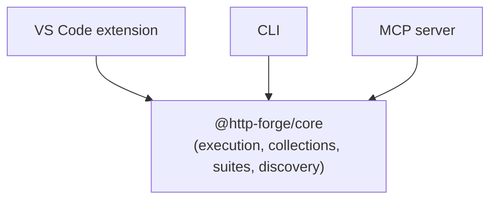

# Why I built a CLI when I already had a VS Code extension

HTTP Forge started as a VS Code extension. That was the right place to start: the editor is where you write the code, so it's where you want to inspect responses and fix requests.

But the extension had a ceiling. A GUI can't run on a build server, can't be piped into `jq`, and can't be driven cheaply by an AI agent. The more I used HTTP Forge for real work, the more the missing piece was obvious: a CLI.

This is why I built one, what it's for, and where it still makes sense to use the extension or the MCP server instead.

## The CLI is the same engine, without the UI

The CLI isn't a separate implementation. It's a thin adapter over the same core (`@http-forge/core`) as the extension and the MCP server.



That matters for three reasons:

1. **Parity.** A bug fixed in the runner is fixed everywhere. A collection that works in the extension works in CI.
2. **No export step.** There's no "export for CI" format to maintain. The CLI reads the same workspace files.
3. **One mental model.** Collections, environments, suites, assertions, reporters — the same concepts across all three surfaces.

## Reason 1: CI doesn't run GUIs

The first real requirement was running a suite on every pull request. That means:

- No editor, no display, no interactive prompts.
- A deterministic exit code.
- A machine-readable report.

The CLI does that:

```bash
http-forge run suite "smoke-tests" \
  --environment staging \
  --reporter junit:results/junit.xml \
  --exit-code
```

Exit `0` when everything passes, `1` when an assertion fails. JUnit XML for GitHub Actions, GitLab, Jenkins, Azure DevOps. That's the whole integration.

The alternative — Newman or a custom script — can work, but it means a second runtime, a second set of flags, and a second place for behavior to drift. Reusing the same engine removes that entire category of "works locally, fails in CI" bugs.

## Reason 2: AI agents are cheaper with a CLI than a tool schema

This is the part people underestimate.

An MCP server is a great interface for structured operations: validated arguments, typed results, discoverable tools. But every tool you expose costs context. The agent has to see the tool name, description, and JSON schema — and that overhead is paid on *every* turn, whether or not the tool is used.

A CLI is just text. An agent that has terminal access can run:

```bash
http-forge run collection "My API" --environment staging --include failedOnly --output json
```

That's a fraction of the tokens of a tool schema plus a tool call. And the agent already knows how to run shell commands.

For the common case — "run the tests and tell me what failed" — the CLI is the most token-efficient interface we have.

### Where MCP still wins

I'm not arguing the CLI replaces MCP. They're good at different things:

- **MCP for structured state changes** — creating requests, editing suite nodes, selecting environments, healing assertions. Validated tools beat string-parsing CLI commands.
- **MCP for rich inspection** — `explain_failure` returns the request, response, assertion results, and a diagnosis in one structured payload. Via CLI you'd run a command and parse JSON.
- **CLI for execution** — run the suite, get a compact summary, move on.

The pattern I recommend to agents: **execute via CLI, mutate via MCP.** It keeps token usage low without giving up structure where structure matters.

## Reason 3: Composability

A CLI is scriptable by default. The output is JSON, so you can pipe it:

```bash
http-forge run suite smoke-tests --output json | jq '.failedRequests[].name'
```

```bash
# Fail only if the auth suite is broken
http-forge run folder "Auth" --collection "My API" --output json \
  | jq -e '.allPassed == true'
```

```bash
# Loop over environments
for env in dev staging production; do
  http-forge run suite "smoke-tests" --environment "$env" --exit-code || exit 1
done
```

None of that is possible in a GUI, and all of it is awkward through a tool-call API. The CLI is where HTTP Forge becomes a Unix citizen.

## Reason 4: Local-first, no account, no daemon

The CLI runs locally. It doesn't phone home, doesn't need a login, and doesn't start a background service.

That matters for:

- **Air-gapped environments** — CI runners and secure networks where outbound access is restricted.
- **Reproducibility** — the same binary and the same workspace produce the same result.
- **Cost** — no per-seat or per-run pricing.

It also makes the CLI the easiest way to try HTTP Forge. One `npm install -g`, one command, and you're running a real suite.

## Reason 5: The CLI is the on-ramp to everything else

A lot of HTTP Forge features are easier to discover from the terminal:

```bash
http-forge discover --path ./backend --output table
http-forge generate-suite --path ./backend --collection "My API" --dry-run
http-forge drift --path ./backend
http-forge qa --path ./backend --base-url http://localhost:3000
```

Discovery, suite generation, drift checks, and the QA gate all work headlessly. You can see the output, script around it, and only then decide whether to open the editor.

The CLI is also how I onboard people: `http-forge launch --examples` clones a sample workspace and opens it in VS Code, so there's no "set up a project first" step.

## What the CLI deliberately doesn't do

A few non-goals kept the scope sane:

- **It's not a TUI.** No interactive browser, no menus. If you want to explore responses visually, use the extension.
- **It's not a deployment tool.** It runs tests; it doesn't provision environments or deploy services.
- **It doesn't duplicate core logic.** Every command delegates to the shared engine. If a behavior lives in the CLI only, it's a bug.
- **It doesn't hide errors.** Exit codes are meaningful, and JSON output includes the failure details rather than a generic "something went wrong."

## The result

The CLI turned HTTP Forge from "a tool I open" into "a tool I can automate." It's the piece that made the project useful in CI, useful to AI agents, and useful in scripts.

If you're building a developer tool, my advice is to build the CLI early — not as an afterthought after the GUI. It forces you to keep the core headless, testable, and free of UI assumptions. Those constraints make every other surface better.

## Try it

```bash
npm install -g @http-forge/cli

# Run a collection in CI
http-forge run collection "My API" --environment staging --reporter junit:results/junit.xml --exit-code

# Explore a sample workspace
http-forge launch --examples
```

- **CLI reference:** https://github.com/hsl1230/http-forge.cli/blob/main/docs/cli-reference.md
- **Open-source core:** https://github.com/hsl1230/http-forge.core
- **HTTP Forge for VS Code:** https://marketplace.visualstudio.com/items?itemName=henry-huang.http-forge
