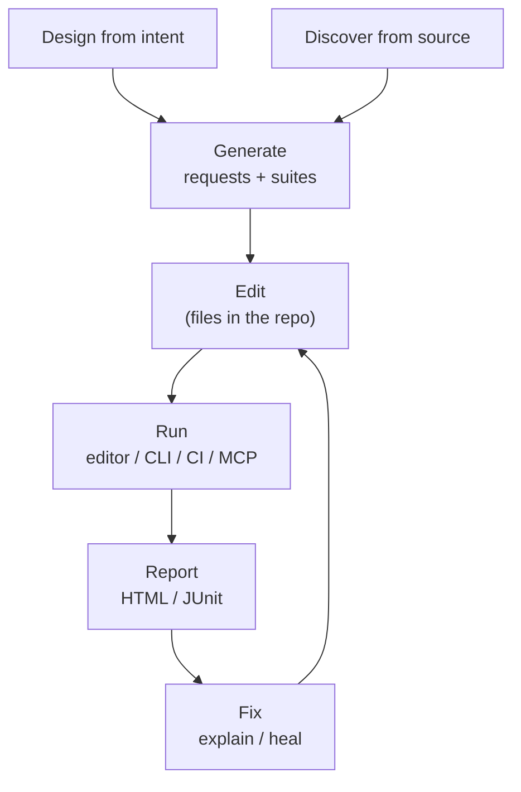
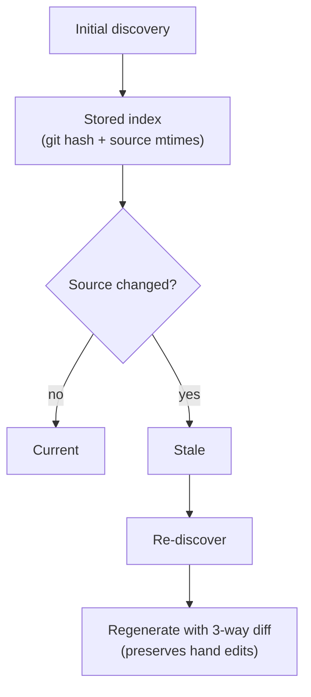

# Why I built HTTP Forge when Postman, Thunder Client, Bruno, and Insomnia already exist

A fair question: the API testing space is crowded. Postman is the default, Thunder Client is inside VS Code, Bruno made collections git-native, and Insomnia has a loyal following. Why build another one?

Because none of them solved the problem I actually had — and the biggest part of that problem was making the whole test lifecycle something an **AI agent could actually drive**, not just a chat panel bolted onto a request composer.

That's the most important win of HTTP Forge: it is **AI-native and AI-driven**. Everything else in this article — the source discovery, the file model, the CLI, the drift detection — exists to make that possible.

## The problem wasn't "send an HTTP request"

Sending a request is a solved problem. Every one of those tools does it well. My problem was the lifecycle *after* the first request worked:

1. The API grows to dozens of endpoints.
2. Someone hand-authors requests and assertions in a collection.
3. The backend changes — a route moves, a DTO gains a field, an auth header changes.
4. The collection goes stale.
5. Nobody trusts it, so nobody runs it.
6. Six months later it's deleted and rewritten from scratch.

That cycle is the maintenance tax. It's not a tooling bug; it's a structural problem. A collection is a *copy* of your API, maintained by hand, with no link back to the source of truth.

I wanted a tool where the tests could be **derived from the code** and **regenerated when the code changed** — without losing the assertions I'd hand-edited.

## What the existing tools get right

I don't think the incumbents are bad. They're good at different things:

- **Postman** — the best onboarding, the biggest ecosystem, great for sharing with non-developers. If your team already lives in it, the switching cost is real.
- **Thunder Client** — the lowest-friction option if you're already in VS Code. Open the panel, send a request, done.
- **Bruno** — collections as plain text files. A genuine improvement for version control, and a strong local-first stance.
- **Insomnia** — a polished UI and a good developer experience, especially for GraphQL.

The gap wasn't the request composer. It was the connection between the request composer and the codebase.

## The gap, and the loop that closes it

Most tools treat the collection as the artifact. For an existing backend, HTTP Forge treats the **source code** as the source of truth and lets the collection be derived from it. For a greenfield API, the designed OpenAPI spec fills that role until there's source to discover.



That full lifecycle — **design from intent or discover from source → generate → edit → run → report → fix → re-run** (see [Getting Started](https://github.com/hsl1230/http-forge/blob/HEAD/docs/user-guide/getting-started.md)) — is the whole idea. Design covers the greenfield case (`http-forge architect`, MCP `design_api_from_intent`); discovery covers the existing backend and runs at the start of the loop, not only after a change. Everything after that operates on the same files.

The lifecycle is actor-agnostic. Every step can be driven by a human in the extension or CLI, or by an AI agent through the MCP server and CLI. You can accept the generated requests and suites as-is and run them — **no manual edit is required** to get a working, runnable suite — or edit any file at any stage. The artifacts are plain files with published schemas, so both a person and an agent can read, validate, and change them.

The loop changes the maintenance equation:

- You don't hand-author requests for every endpoint.
- You don't lose hand-edited assertions when you regenerate.
- You get told when the source has drifted from the stored index.
- The agent that discovers an endpoint can write the request, generate the suite, run it, read the JUnit report, and propose an assertion fix without a translation layer.

Postman can't do this because it doesn't read your backend. Bruno can't because it's a collection store, not a code analyzer. Thunder Client is a client. That's not a criticism — it's a different category.

Drift is a separate maintenance check on top of the lifecycle:



## What HTTP Forge actually is

HTTP Forge is three surfaces over one engine:

- **VS Code extension** — request tester, collections tree, test suites, environment editor, discovery view.
- **CLI** — headless runs, CI integration, discovery, suite generation, QA gate, drift checks.
- **MCP server** — 60+ tools so AI agents can discover, generate, run, diagnose, and heal tests.

They share `@http-forge/core`, which is open source (MIT). That matters because it means the behavior is the same everywhere: a collection that runs in the editor runs in CI, and an agent calling `run_suite` uses the same engine as `http-forge run suite`.

### The most important win: the lifecycle is AI-native

In most API tools I've used, AI is an assistant inside the UI: "generate an assertion," "explain this response." That's useful, but the agent is still working inside a human's workflow. It can't operate the tool end-to-end.

HTTP Forge was designed the other way around. The MCP server exposes the whole lifecycle as tools:

- `design_api_from_intent` → design a greenfield API.
- `create_request_from_endpoint` / `generate_test_suite` → discover and generate.
- `run_request` / `run_collection` / `run_suite` → execute.
- `get_run_summary` / `get_failed_requests` / `explain_failure` → diagnose.
- `heal_assertions` + `set_request_script` → propose and apply a fix.

An agent can chain those calls to go from source code to a green test run without a human hand-editing a request. A human can also do every step through the extension or CLI. The same files, the same engine, the same results — the only difference is who is driving.

In practice, the cheapest split is: **CLI for execution** (one command, compact JSON, low token cost) and **MCP for structured state changes and rich inspection** (validated arguments, `explain_failure`, `heal_assertions`). Both operate on the same workspace, so the agent can switch without a translation layer.

**Why this works is the file model.** The agent isn't calling an opaque API and hoping the state is right. It's reading and writing documented JSON files in the same workspace as the code, with published schemas to validate against. It can inspect a `request.json`, see the controller it targets, edit the `*.suite.json`, run it, read the JUnit report, and fix the assertion — all in one context. That's the difference between "AI-assisted" and "AI-native."

### One command to a dedicated window

A common objection to "it's a VS Code extension" is setup friction: *I don't want to assemble an editor profile just to try an API client.*

So the CLI can do it for you:

```bash
http-forge launch --test
```

That downloads VS Code if needed, installs HTTP Forge and GitHub Copilot into an isolated `"HTTP Forge"` profile, and opens a dedicated window with no other extensions competing for space. Add `--examples` and it clones a sample workspace with ready-to-run collections and suites.

It's still VS Code under the hood — not a standalone desktop app — but it removes the setup step. For someone who just wants to try the tool, that's the difference between "install and go" and "configure an editor first."

## The workspace is the database

This is the decision I'd make again first: HTTP Forge stores requests and suites as **plain files in the same workspace as the code**, not in an opaque app database.

```text
my-project/
├── src/                         # your backend
└── .http-forge/                 # or a configured storage root
    ├── collections/
    │   └── my-api/
    │       ├── collection.json
    │       ├── auth/
    │       │   ├── folder.json
    │       │   └── login/
    │       │       ├── request.json
    │       │       └── scripts/
    │       │           ├── pre-request.js
    │       │           └── post-response.js
    │       └── users/
    │           └── get-users/
    │               └── request.json
    ├── suites/
    │   └── smoke-tests.suite.json
    └── environments/
        └── staging.json
```

Why files matter:

- **They diff like code.** A request change shows up in a PR. A suite change is reviewable. Nothing is hidden in a binary store.
- **They live with the code.** An AI agent working in the repo can read the request and the controller it tests in the same context — no export, no copy, no synchronisation step.
- **They have schemas.** Collections, folders, requests, suites, environments, and config all have published JSON Schema definitions (`collection.schema.json`, `folder.schema.json`, `request.schema.json`, `suite.schema.json`, `environment.schema.json`, `http-forge.config.schema.json`). An agent can validate what it writes instead of guessing at a shape.
- **They're portable.** Move the folder, commit it, branch it, or let CI read it. There's no migration tool.

That combination — pure files + published schemas + the code in the same workspace — is what makes agent-driven work practical. The agent isn't calling an opaque API and hoping; it's editing a documented artifact in the repo, and the tool validates it.

### Source control is the collaboration model

Because the artifacts are files, git is the collaboration layer — not a proprietary sync service.

- **Reviewable changes.** `git diff` on a `request.json` or `*.suite.json` shows exactly what changed: URL, headers, assertions, suite nodes. Reviewers can approve or reject a test change the same way they review application code.
- **Blame and history.** `git blame` tells you who changed an assertion and when. `git log -p` shows the evolution of a suite. That context is lost in an opaque tool database.
- **Branches and PRs.** A feature branch can change the API and its tests together. The test change is part of the same PR, reviewed by the same people, merged atomically.
- **Merge conflicts are normal text conflicts.** Two people editing different requests don't collide. Two people editing the same assertion get a standard conflict to resolve, not a "collection is locked" error.
- **CI reads the same commit.** The pipeline runs the exact tests that were reviewed in the PR — no export, no upload, no "which version is in the cloud?" question.
- **Works in monorepos.** Point the storage root at a subfolder and keep API tests next to the service they cover.

That's the practical difference from a cloud collection: version control stops being an afterthought and becomes the way tests are shared, reviewed, and kept honest.

## Design decisions that came from the problem

A few choices only make sense in hindsight, but they all trace back to "tests must survive change":

**1. Discovery reads source, not specs.**
OpenAPI is great when it exists. It often doesn't, or it's stale. Reading source means there's no spec maintenance step before you can test. Six providers today: Express, NestJS, Fastify, AWS Lambda, Spring, FastAPI.

**2. Generated artifacts are marked as generated.**
Suites generated from discovery carry `ai_generated: true` and `derived_from: <endpointId>`. That provenance is what makes safe regeneration possible: only generated regions are regenerable; hand edits are preserved.

**3. Drift is a first-class concept.**
The index stores a git hash and source mtimes. In a git work tree, drift compares the current HEAD hash; without git, it degrades to mtime-only. No signal at all? It reports `unknown` rather than pretending everything is fine.

**4. The CLI is not an afterthought.**
Building the CLI early forced the core to stay headless and UI-free. That's why the MCP server and CI integration were straightforward later.

**5. AI-native is the point, not a feature.**
The MCP tools aren't a chat add-on; they're the lifecycle exposed as tools. An agent can discover, generate, run, diagnose, and heal without hand-editing anything, and every artifact it produces is plain text in the repo, so a human can review, edit, or revert it. Output is bounded, errors are structured, and `heal_assertions` is advisory: the agent writes the new script, and the change is visible in git like any other edit. There's no hidden state and no "AI silently rewrites your tests" path. This is the win everything else is built to support.

## What I deliberately didn't build

Scope is a feature.

- **Not a standalone desktop app.** HTTP Forge lives in VS Code and the terminal. If you want a separate app window, Bruno or Postman are better fits.
- **Not a cloud service.** No account, no sync, no per-seat pricing. Local-first by default.
- **Not a replacement for contract testing.** Pact and schema validation solve a different problem. HTTP Forge generates and runs functional tests; pair it with contract testing when you need it.
- **Not a full API design/management suite.** `http-forge architect` can generate a starting OpenAPI spec, but design-first collaboration and mocking still belong in dedicated tools.

## Who it's for

HTTP Forge is for teams that:

- Are willing to work in VS Code or the terminal.
- Have a backend whose source they can point at.
- Are tired of hand-maintaining collections.
- Want tests that run in CI and can be driven by an AI agent.

It's probably *not* for you if:

- You need a standalone desktop client.
- Your API has no accessible source (third-party APIs). In that case, import an OpenAPI spec or use a collection-first tool.
- Your team is deeply invested in Postman's ecosystem (monitors, mock servers, shared workspaces) and the switching cost outweighs the maintenance savings.

## The honest pitch

Postman, Thunder Client, Bruno, and Insomnia are good tools. I used them. HTTP Forge exists because I wanted something they don't do: **make the entire API-test lifecycle something an AI agent can drive, while keeping the tests connected to the code that defines the API.**

The AI-native part is the headline. The source discovery, plain-file workspace, published schemas, CLI, and drift detection are what make that headline real instead of a demo.

That's the bet. If it resonates, try it:

```bash
npm install -g @http-forge/cli
http-forge launch --examples
```

That clones a sample workspace with pre-built requests, environments, and suites, and opens it in VS Code. No account and no manual setup.

- **HTTP Forge for VS Code:** https://marketplace.visualstudio.com/items?itemName=henry-huang.http-forge
- **Open-source core:** https://github.com/hsl1230/http-forge.core
- **CLI docs:** https://github.com/hsl1230/http-forge.cli/blob/main/docs/cli-reference.md

If you've solved the "collections rot" problem differently, I'd genuinely like to hear how. That's the conversation this article is meant to start.
