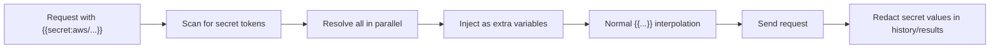

# Secret Providers (`{{secret:alias/path}}`)

HTTP Forge can pull secrets directly from external secret managers at request time using the
`{{secret:alias/path}}` token. The secret value is **never stored** in HTTP Forge config,
history, or result files — the provider fetches it on demand using your ambient credentials
and the resolved value is [redacted](security.md) before anything is written to disk.

This works identically in the **VS Code extension** and the **`@http-forge/cli`** standalone runner.

> Looking for simpler options? For per-developer secrets that don't need a cloud vault, see
> [OS Keychain secrets](environments-variables.md#os-keychain-secrets-recommended) and
> [Local secrets](environments-variables.md#local-secrets) in the Environments guide.

---

## Supported providers

| Alias (default) | Provider | Token syntax | Authentication source | SDK required |
|---|---|---|---|---|
| `aws` | AWS Secrets Manager | `{{secret:aws/<secretId>[#jsonField]}}` | SDK chain (configured `profile`, env, `~/.aws`, IAM role, ECS) | `@aws-sdk/client-secrets-manager` |
| `azure` | Azure Key Vault | `{{secret:azure/<name>[/<version>]}}` | `DefaultAzureCredential` (env, managed identity, CLI) | `@azure/keyvault-secrets`, `@azure/identity` |
| `gcp` | Google Secret Manager | `{{secret:gcp/<name>[/versions/<n>]}}` | Application Default Credentials | `@google-cloud/secret-manager` |
| `vault` | HashiCorp Vault (KV v2) | `{{secret:vault/<path>[#field]}}` | `VAULT_TOKEN` + `VAULT_ADDR` | none (built-in `fetch`) |
| `op` | 1Password | `{{secret:op/<item>/<field>}}` | `OP_SERVICE_ACCOUNT_TOKEN`, configured desktop `account`, or `op` CLI session | optional `@1password/sdk` (0.5+ for desktop account) |
| `doppler` | Doppler | `{{secret:doppler/<NAME>}}` | `DOPPLER_TOKEN` service token | none (built-in `https`) |

All six built-in aliases are **pre-registered out of the box** — you can use
`{{secret:aws/...}}` etc. with zero configuration as long as the matching
credentials/environment variables are present. See [Zero-config defaults](#zero-config-defaults).

Not on the list? Register a workspace resolver module with the
[custom provider](#custom-providers) type.

> **First time using a provider?** The credentials column shows the mechanism; the
> [authentication walkthroughs](#authenticating-http-forge) give the actual sign-in commands,
> verification steps, and minimum permissions for each provider.

---

## How it works

1. Before a request runs, `RequestPreparer` scans the whole request (URL, headers, query, body,
   auth) for `{{secret:alias/path}}` tokens.
2. All distinct tokens are resolved **in parallel**, _before_ normal `{{variable}}` interpolation.
3. Each resolved value is injected as an extra variable, so the normal (synchronous) template
   engine substitutes it transparently — exactly like any other `{{...}}` token.
4. Values are **cached for the lifetime of a single request** so the same secret isn't fetched twice.
5. If a token's alias isn't configured, or the provider call fails, a warning is logged and the
   token is **left as-is** in the output (visible in history as an unresolved template). The
   request is not aborted.



**No credentials are ever stored in HTTP Forge config.** Each provider uses its own
ambient credential chain (env vars, cloud identity, CLI session). The `secrets` block only
holds non-sensitive routing info such as region, vault URL, project ID, or a 1Password desktop
account name.

---

## Authenticating HTTP Forge

HTTP Forge has no sign-in screen and no credential store of its own. It resolves
`{{secret:...}}` tokens from inside the **VS Code extension host** or the **CLI process**, so
each resolver uses that provider's normal authentication mechanism:

- **AWS, Azure, GCP** — the provider SDK's standard credential chain, including credentials
  created by `aws configure`, `az login`, or `gcloud auth application-default login`.
- **Vault, Doppler** — a token read from the process environment (`VAULT_TOKEN`,
  `DOPPLER_TOKEN`).
- **1Password** — an `OP_SERVICE_ACCOUNT_TOKEN` (service account via the SDK), a configured
  desktop `account` (personal account via the SDK), or a signed-in `op` CLI session. SSO
  (for example TCI PingFed) is handled by the 1Password desktop app; HTTP Forge never handles
  the identity-provider login itself.
- **Custom** — whatever your module uses. Keep credentials in `process.env` or the provider's
  own SDK/CLI session, not in the `options` block.

The `secrets.providers` block holds routing information (region, vault URL, project ID, the
1Password desktop account name, custom options) and, for Doppler, an optional `serviceToken`
override. Prefer `DOPPLER_TOKEN` so the token stays out of config.

Provider SDKs are separate from authentication: AWS, Azure, and GCP need their SDK installed
(see [Installing the provider SDKs](#installing-the-provider-sdks)), while Vault and Doppler
use built-in Node APIs. 1Password uses the `op` CLI or the optional `@1password/sdk`. The
SDK is used for service-account tokens and for the desktop `account` path; if the SDK is
missing, the resolver falls back to the CLI where possible. Custom providers may use any
package installed in `scripts.modulePaths`.

### VS Code: the extension host has its own environment

The extension reads `process.env` of the **VS Code extension host**, not the environment of
an integrated terminal. If you export a token in a terminal and the resolver still says it is
missing:

1. Quit VS Code completely.
2. In the shell where the variable is exported (or where `op signin`/`vault login` succeeded),
   run `code .` to launch VS Code with that environment.
3. Or set the variable at the OS/user-session level and restart VS Code.

Credential **files** and OS keychains/CLI caches are read directly by the provider, so they do
not need to be exported: `~/.aws/*`, the Azure CLI token cache, Application Default
Credentials, and the 1Password desktop integration all work as long as the tool that created
them ran as the same OS user as VS Code. The CLI inherits its shell, so
`VAULT_TOKEN=... http-forge run-suite ...` works as expected.

The extension also needs any CLI it shells out to on the extension host's `PATH` — notably
`az` for Azure and `op` for 1Password. If a terminal can find them but the extension cannot,
launch VS Code from that shell or fix the GUI session's `PATH`.

### Sign-in quick reference

| Provider | Local sign-in | What HTTP Forge reads | Minimum permission |
|---|---|---|---|
| AWS Secrets Manager | `aws configure`, or `aws configure sso` + `aws sso login --profile <profile>` | SDK credential chain + `profile`/`region` config or env | `secretsmanager:GetSecretValue`; `kms:Decrypt` for a customer-managed key |
| Azure Key Vault | `az login` | `DefaultAzureCredential` + `AZURE_KEYVAULT_URL` | `Key Vault Secrets User` role, or secret `Get` access policy |
| Google Secret Manager | `gcloud auth application-default login` | Application Default Credentials + `projectId` or `GOOGLE_CLOUD_PROJECT` / `GCLOUD_PROJECT` / `GCP_PROJECT` | `roles/secretmanager.secretAccessor` |
| HashiCorp Vault | `vault login ...`, then export `VAULT_TOKEN` | `VAULT_TOKEN` + `VAULT_ADDR` + `VAULT_NAMESPACE` | `read` on the KV v2 data path |
| 1Password | `op signin`, set `OP_SERVICE_ACCOUNT_TOKEN`, or configure `account` | `op` CLI session, service-account token, or desktop-app account | read access to the vault/item |
| Doppler | create a service token, then export `DOPPLER_TOKEN` | `DOPPLER_TOKEN` or `serviceToken` | service token scoped to the project/config |

### AWS Secrets Manager sign-in

AWS uses the SDK's default credential chain, so there is no HTTP Forge-specific login. Sign
in with the AWS CLI, or run in an AWS role. Pick one of the paths below.

#### 1. Install the AWS SDK

HTTP Forge does not bundle the SDK. Install `@aws-sdk/client-secrets-manager` where HTTP
Forge resolves packages; see [Installing the provider SDKs](#installing-the-provider-sdks).
For the VS Code extension, that is normally:

```bash
cd .http-forge/assets/lib
npm install @aws-sdk/client-secrets-manager
```

Add that directory to `scripts.modulePaths` if your configuration does not already point
there.

#### 2. Sign in

**Local access key**

```bash
aws configure
# Enter AWS Access Key ID, AWS Secret Access Key, default region, and output format.
aws sts get-caller-identity
```

**IAM Identity Center (AWS access portal)**

```bash
aws configure sso --profile my-profile
# At the prompts:
#   SSO start URL: https://<org>.awsapps.com/start
#   SSO region:    the IAM Identity Center region (not necessarily the secret region)
#   Account:       the account ID shown in the access portal
#   Role:          a role that can read the secret
#   Client region: the region that contains the secret
#   Profile name:  my-profile

aws sso login --profile my-profile
aws sts get-caller-identity --profile my-profile
```

- The account ID is stored in the SSO profile (`sso_account_id`); HTTP Forge does not need it
  separately.
- SSO tokens expire. Run `aws sso login --profile <profile>` again when they do.
- If the secret is in a different account, configure a cross-account role in the profile
  rather than copying credentials into HTTP Forge.

**AWS-hosted workloads**

On EC2, ECS, or Lambda, use the instance, task, or execution role. There is no local sign-in.

#### 3. Configure the profile and region

Add an `aws` entry under `secrets.providers` in `http-forge.config.json`:

```json
{
  "aws": {
    "provider": "aws",
    "profile": "my-profile",
    "region": "us-east-1"
  }
}
```

- `profile` selects a named or SSO profile from `~/.aws/config` and
  `~/.aws/credentials`. The SDK uses it for both credentials and profile settings, so
  `AWS_PROFILE` does **not** need to be visible to the extension host.
- `region` is optional. It falls back to `AWS_DEFAULT_REGION`, then `AWS_REGION`; if neither
  is set, the SDK uses the profile's region.
- If `profile` is omitted, `AWS_PROFILE` still selects the profile. The SDK also reads
  `AWS_ACCESS_KEY_ID`, `AWS_SECRET_ACCESS_KEY`, and `AWS_SESSION_TOKEN`.
- `aws sso login --profile my-profile` still writes its token cache under `~/.aws/sso/cache`.
  Run it as the same OS user that runs VS Code; no environment export is needed.

#### 4. Grant access

- `secretsmanager:GetSecretValue` on the secret.
- `kms:Decrypt` if the secret uses a customer-managed KMS key.

#### 5. Verify and use

```bash
aws secretsmanager get-secret-value \
  --secret-id myapp/prod \
  --query SecretString \
  --output text
```

For an SSO profile, add `--profile my-profile --region us-east-1`.

```http
{{secret:aws/myapp/prod}}
{{secret:aws/myapp/prod#db_password}}
```

- Append `#field` to read one field from a JSON secret.
- In CI, prefer OIDC role assumption over long-lived access keys (see [CI/CD](#cicd)).

### Azure Key Vault sign-in

Azure uses `DefaultAzureCredential`, so there is no HTTP Forge-specific login. Sign in with
the Azure CLI, a service principal, or a managed identity.

#### 1. Install the Azure SDKs

HTTP Forge does not bundle the SDKs. Install both packages where HTTP Forge resolves
packages; see [Installing the provider SDKs](#installing-the-provider-sdks). For the VS Code
extension, that is normally:

```bash
cd .http-forge/assets/lib
npm install @azure/keyvault-secrets @azure/identity
```

Add that directory to `scripts.modulePaths` if your configuration does not already point
there.

#### 2. Sign in

```bash
# Add --tenant when your account spans multiple tenants
az login
# az login --tenant <tenant-id>

# Select the subscription that owns the vault
az account set --subscription "<subscription-id-or-name>"
az account show
```

- `DefaultAzureCredential` checks environment credentials, managed identity, and the Azure
  CLI session, so no `AZURE_*` variables are needed for interactive use.
- The `az` CLI must be on the extension host's `PATH`.

#### 3. Configure the vault URL

```json
{ "azure": { "provider": "azure", "vaultUrl": "https://my-vault.vault.azure.net" } }
```

- `vaultUrl` falls back to `AZURE_KEYVAULT_URL`.
- Use the vault URL, not the secret URL: `https://<vault-name>.vault.azure.net`.

#### 4. Grant access

- Grant the identity the **Key Vault Secrets User** RBAC role on the vault, or use a vault
  access policy with the secret `Get` permission.

#### 5. Verify and use

```bash
az keyvault secret show \
  --vault-name my-vault \
  --name oauth-client-secret \
  --query value -o tsv
```

```http
{{secret:azure/oauth-client-secret}}
{{secret:azure/oauth-client-secret/1.0}}
```

The second form pins a secret version.

#### Service principals, managed identity, and CI

- For a service principal, expose `AZURE_TENANT_ID`, `AZURE_CLIENT_ID`, and
  `AZURE_CLIENT_SECRET` to the process that runs HTTP Forge.
- For Azure-hosted workloads, use a managed identity instead of a secret.
- In CI, prefer workload identity federation or a managed identity over a long-lived client
  secret.

### Google Secret Manager sign-in

`gcloud auth application-default login` is the only **sign-in** step HTTP Forge itself
needs, but it is not the only setup step. HTTP Forge uses Application Default Credentials
(ADC). There is no region setting; the project ID selects the project that owns the secret.

ADC and the `gcloud` CLI use separate credentials: `gcloud auth application-default login`
does not authenticate `gcloud` commands such as `gcloud secrets versions access`.

#### 1. Install the GCP SDK

HTTP Forge does not bundle the SDK. Install `@google-cloud/secret-manager` where HTTP Forge
resolves packages; see [Installing the provider SDKs](#installing-the-provider-sdks). For
the VS Code extension, that is normally:

```bash
cd .http-forge/assets/lib
npm install @google-cloud/secret-manager
```

Add that directory to `scripts.modulePaths` if your configuration does not already point
there.

#### 2. Sign in with ADC

```bash
gcloud auth application-default login
```

This opens a browser. For a Google Workspace/SSO organization, complete the login through
your identity provider. Use `application-default login`, not just `gcloud auth login`; the
latter authenticates the CLI but does not create the credentials the SDK reads.

#### 3. Configure the project ID

HTTP Forge does **not** read `gcloud config set project`. Set `projectId` in
`http-forge.config.json`:

```json
{
  "secrets": {
    "providers": {
      "gcp": { "provider": "gcp", "projectId": "my-project-123" }
    }
  }
}
```

Or export `GOOGLE_CLOUD_PROJECT` (fallback: `GCLOUD_PROJECT`, then `GCP_PROJECT`).
`gcloud config set project my-project-123` only changes the `gcloud` CLI's active project;
it is useful for the verification command below, but it does not configure HTTP Forge.

#### 4. Grant access

- Grant `roles/secretmanager.secretAccessor` on the secret or project.
- Enable the Secret Manager API in that project.
- If the secret uses a customer-managed encryption key (CMEK), the identity also needs the
  appropriate Cloud KMS decrypt permission.
- If the secret is in a different project, set `projectId` to the project that owns the
  secret and grant access there.

Verify the ADC path HTTP Forge uses. From `.http-forge/assets/lib` (or wherever the SDK is
installed):

```bash
node - <<'NODE'
const { SecretManagerServiceClient } = require('@google-cloud/secret-manager');
const client = new SecretManagerServiceClient();
client
  .accessSecretVersion({
    name: 'projects/my-project-123/secrets/oauth-client-secret/versions/latest'
  })
  .then(([response]) => {
    const bytes = response.payload?.data?.length ?? 0;
    console.log(`ADC read succeeded (${bytes} bytes)`);
  })
  .catch((error) => {
    console.error(error.message);
    process.exit(1);
  });
NODE
```

This checks the same ADC identity and SDK call HTTP Forge uses without printing the secret.

The `gcloud secrets versions access` command uses the separate **gcloud CLI** login, not
ADC. To use that command, also run:

```bash
gcloud auth login
gcloud config set project my-project-123
gcloud secrets versions access latest \
  --secret="oauth-client-secret" \
  --project="my-project-123"
```

Add `| wc -c` if you do not want the secret printed to the terminal.

#### 5. Use the secret

```http
{{secret:gcp/oauth-client-secret}}
{{secret:gcp/oauth-client-secret/versions/3}}
```

#### VS Code, remote sessions, and containers

ADC is read from the OS user profile of the extension host. If VS Code runs as the same OS
user, no environment variable is needed. If you use `GOOGLE_APPLICATION_CREDENTIALS`, quit
VS Code and relaunch it from the shell that exports the variable, or set it at the
OS/user-session level. In a Remote-SSH, WSL, or dev-container session, run
`gcloud auth application-default login` in that environment, not only on your local machine.

#### Service accounts and CI

For a service account, either point `GOOGLE_APPLICATION_CREDENTIALS` at the key file, or
impersonate the account:

```bash
gcloud auth application-default login \
  --impersonate-service-account="forge-reader@my-project-123.iam.gserviceaccount.com"
```

In CI, prefer Workload Identity Federation over service-account key files.

### HashiCorp Vault sign-in

Vault uses a token, and no SDK is needed; the resolver uses the KV v2 HTTP API. HTTP Forge
reads `VAULT_TOKEN` from the process environment; it does not read `~/.vault-token` or the
Vault CLI token helper.

#### 1. Set the server

```bash
export VAULT_ADDR="https://vault.corp.com"
# For HCP Vault Dedicated or Vault Enterprise namespaces:
# export VAULT_NAMESPACE="admin"
```

#### 2. Sign in and export the token

```bash
# Interactive OIDC (or -method=userpass / -method=ldap)
vault login -method=oidc

# HTTP Forge reads VAULT_TOKEN, not ~/.vault-token
export VAULT_TOKEN="$(vault print token)"
```

To put the token in the environment in one step without using the token helper:

```bash
export VAULT_TOKEN="$(vault login -token-only -method=userpass username=alice)"
```

Make sure the export is visible to the VS Code extension host. Quit VS Code and relaunch it
from the authenticated shell, or set the variable at the OS/user-session level.

#### 3. Configure the connection

```json
{
  "vault": {
    "provider": "vault",
    "address": "https://vault.corp.com",
    "mountPath": "secret",
    "namespace": "admin"
  }
}
```

- `address` falls back to `VAULT_ADDR` (default `http://127.0.0.1:8200`).
- `mountPath` defaults to `secret`.
- `namespace` falls back to `VAULT_NAMESPACE`.
- The token path is relative to `mountPath`; do not repeat the mount in the token. (`vault kv
  get` still takes the mount as part of its path.)

#### 4. Grant access

- The token policy needs `read` on `<mount>/data/<path>` (for example,
  `secret/data/myapp/prod`).
- The resolver uses the KV v2 API.

#### 5. Verify and use

```bash
vault kv get secret/myapp/prod
```

```http
{{secret:vault/myapp/prod#db_password}}
{{secret:vault/myapp/prod}}
```

- With no `#field`, HTTP Forge returns the `value` key if it exists, or the only key in the
  secret.
- In CI, inject a short-lived token from the CI secret store, or authenticate with AppRole
  before running the CLI.

### 1Password sign-in

1Password has three credential paths. Pick the one that matches your setup:

| Path | Use when | Requires |
|---|---|---|
| Service account | Unattended/CI, or no desktop app | `OP_SERVICE_ACCOUNT_TOKEN`; SDK preferred, `op` CLI fallback |
| Desktop account | Personal account, including SSO | Desktop app + `account`; SDK 0.5+ for `DesktopAuth`, CLI fallback with `OP_ACCOUNT` |
| CLI session | Interactive personal account | `op` on `PATH` and a signed-in session |

The resolver tries them in this order: service account, configured `account`, CLI session.

The service-account and desktop-account paths use `@1password/sdk`; install it where HTTP
Forge resolves packages (see [Installing the provider SDKs](#installing-the-provider-sdks)).
If the SDK is missing, the resolver falls back to `op` where possible.

**CLI path**

```bash
# Interactive: enable the desktop app integration first:
# 1Password app -> Settings -> Developer -> Integrate with 1Password CLI
op signin
op whoami

# Verify a field
op item get "My App" --vault "Private" --fields label=password --reveal
```

If your organization uses a custom sign-in address, such as
`https://teluscomms.1password.ca/signin`, add the account using the host name only — no
`https://` and no `/signin` path:

```bash
op account add --address teluscomms.1password.ca --email you@example.com
eval $(op signin --account teluscomms)
op whoami
```

Replace `teluscomms` with the shorthand shown by `op account list` if it differs. The sign-in
URL is for the browser only; it is not an HTTP Forge config value.

If you use the desktop app integration, sign in to the 1Password app at that same address and
enable **Settings → Developer → Integrate with 1Password CLI**. Then `op` uses the app's
signed-in account without a separate CLI session.

If your organization uses SSO — for example, **TCI PingFed** — 1Password performs the SSO
login; HTTP Forge never sees your PingFed credentials. For SSO-only accounts, both personal
paths rely on the 1Password desktop app:

- **SDK path:** sign in to the 1Password desktop app with your identity provider, then
  configure `account` (preferably the account UUID). The SDK `DesktopAuth` asks the app for
  access. The `op` CLI and its integration setting are not needed for this path.
- **CLI path:** sign in to the desktop app, enable **Settings → Developer → Integrate with
  1Password CLI**, then run `op whoami` (and `op signin` if prompted to approve the CLI in the
  app). SSO-only accounts cannot use manual `op account add` sign-in because it requires an
  account password and Secret Key.

For unattended or CI use, create a service account instead — service accounts authenticate
with `OP_SERVICE_ACCOUNT_TOKEN` and are independent of SSO.

HTTP Forge does not store the sign-in address in `http-forge.config.json`. The address lives
in one of three places: the 1Password desktop app account (SSO), the CLI account added with
`op account add` (manual sign-in), or the service-account token (already scoped to the
account). If multiple accounts are configured, set `OP_ACCOUNT` to the shorthand shown by
`op account list` in the environment that launches VS Code or the CLI; HTTP Forge passes the
environment through to `op`.

The selected path determines the sign-in command and the environment HTTP Forge needs:

- `op signin` is idempotent and uses Touch ID, Windows Hello, or system authentication when
  the desktop app integration is enabled.
- HTTP Forge runs `op` as a child process with the extension host environment. If you use
  `eval $(op signin)` in a shell, launch VS Code from that shell; otherwise use the desktop
  integration so the CLI can authenticate without an exported session token.
- For a personal account, use the SDK desktop-app path (`account`) or the signed-in `op` CLI
  session; see [Personal account access](#personal-account-access).
- For a service account (recommended for CI), set `OP_SERVICE_ACCOUNT_TOKEN`; see the
  [Service account runbook](#service-account-runbook) for the full unattended setup.
- `vault` in config is a default vault, not a credential. With it set, use
  `{{secret:op/<item>/<field>}}`; without it, use `{{secret:op/<vault>/<item>/<field>}}`.
- The item and field must be readable by the signed-in user or service account.

#### Personal account access

If the vault is shared with your personal 1Password account, HTTP Forge supports two paths.
For SSO-only accounts — for example, TCI PingFed with 1Password Unlock with SSO — both paths
rely on the 1Password desktop app because 1Password performs the identity-provider login.

**Desktop-app path (no CLI)**

Set `account` in the 1Password provider config. HTTP Forge uses `@1password/sdk`'s
`DesktopAuth` with the signed-in desktop app. This requires `@1password/sdk` 0.5.0 or newer
and the 1Password desktop app on the extension host. This is the recommended path for SSO.

```json
{ "op": { "provider": "1password", "vault": "Private", "account": "my-account" } }
```

Use the account UUID (preferred for SSO) or the account name shown at the top left of the
desktop app. Sign in to (and unlock) the app before making requests; for SSO, complete the
TCI PingFed login in the app. The CLI and its integration setting are not used on this path.
Do not set `OP_SERVICE_ACCOUNT_TOKEN` for personal access; the service-account token takes
precedence when both are configured.

**CLI path**

Omit `account` and use the signed-in `op` CLI session. This is also the fallback when the SDK
package is not installed. The CLI path requires 1Password CLI v2 on the extension host's
`PATH`.

1. Sign in to the 1Password desktop app with the personal account and enable
   **Settings → Developer → Integrate with 1Password CLI**. For an account with an account
   password and Secret Key, you can instead use `op account add` + `op signin` manually.
   SSO-only accounts cannot use manual sign-in because `op account add` requires those
   credentials.
2. If more than one account is signed in, select the personal account by shorthand:
   ```bash
   export OP_ACCOUNT="my-account"
   op whoami
   ```
   Use the shorthand shown by `op account list`.
3. Launch VS Code from that shell so the extension host inherits `OP_ACCOUNT` and the CLI
   session:
   ```bash
   code /path/to/workspace
   ```
4. Verify the exact value the resolver will read:
   ```bash
   op read "op://<vault>/<item>/<field>"
   ```
   Then use `{{secret:op/<vault>/<item>/<field>}}` in HTTP Forge.

If the CLI cannot see the personal account, run `op whoami` and `op account list` in the
same shell that launches VS Code. The extension host does not inherit exports from an
integrated terminal.

When `account` is set but the SDK package is missing, HTTP Forge falls back to `op read` with
the same value in `OP_ACCOUNT`. If your CLI identifies the account by a different shorthand,
install the SDK or omit `account` and set `OP_ACCOUNT` explicitly.

For SSO (TCI PingFed), the CLI path requires the desktop app integration. If the desktop app
cannot be installed, personal SSO is not available; use a service account with read access to
a shared vault instead.

If the SDK reports that it cannot authenticate the desktop account, make sure the desktop app
is signed in and unlocked through SSO, set `account` to the account UUID, and verify the SDK
is 0.5.0 or newer. If the CLI cannot find the SSO account, enable **Settings → Developer →
Integrate with 1Password CLI** in the app; manually added CLI accounts cannot use SSO-only
sign-in.

#### Service account runbook

A service account needs no desktop app and no interactive CLI sign-in: the token
authenticates `@1password/sdk`, and HTTP Forge reads the token from the environment. The
1Password web app is used only to create the service account and save the token.

**Prerequisites**

- Permission to create service accounts (owner/admin, or a delegated permission). If
  **Developer** is missing from the web app, ask your 1Password administrator.
- A shared vault the service account can read. Service accounts cannot access Personal,
  Private, Employee, or the default Shared vault.
- The account's sign-in address, for example `teluscomms.1password.ca`.

**1. Sign in to the account**

1. Open `https://<account>.1password.ca/signin` — for the Telus account, use
   `https://teluscomms.1password.ca/signin`.
2. Enter your organization email address.
3. If prompted, choose **Sign in with SSO** / **Continue with TCI PingFed**, then complete the
   PingFed login and MFA.
4. If an account switcher appears, select the organization account. If you are already signed
   into a different 1Password account, sign out or use a private browser window first.

You do not need the 1Password desktop app or the `op` CLI for this web setup.

**2. Prepare a shared vault and item**

1. Create or use a shared vault, for example `HTTP Forge`.
2. Add the item HTTP Forge should read, for example an API credential with a `password`
   field.
3. Confirm the field is visible in the web app.

**3. Create the service account**

1. In the web app, open **Developer** → **Directory**.
2. Under **Infrastructure Secrets Management**, choose **Other** / **Service Accounts**, then
   **Create a Service Account**. Some accounts show this as
   **Developer** → **Access Tokens** → **Service Account**.
3. Give it a name, for example `http-forge-local`.
4. Grant **Read Items** on the shared vault. Do not grant **Write Items** or **Share Items**
   unless the integration needs them.
5. Leave **Can create vaults** off and skip 1Password Environments. HTTP Forge's `op`
   provider resolves item secret references, not Environments.
6. Create the service account.
7. When the token appears, choose **Save in 1Password** and save it to a vault. The token is
   shown only once. Do not paste it into chat, email, source control, or
   `http-forge.config.json`.

Service-account vault access and permissions are immutable. If you need access to another
vault later, create a new service account. You can rotate the token without changing access.

Some accounts expose the same wizard path as 1Password.com:

```text
https://<account>.1password.ca/developer-tools/infrastructure-secrets/serviceaccount/
```

If that path does not work, use the sidebar navigation above.

**4. Export the token and launch VS Code**

In the shell that starts VS Code or the CLI:

```bash
export OP_SERVICE_ACCOUNT_TOKEN="ops_..."
code /path/to/workspace
```

The VS Code extension host does not see variables exported in an integrated terminal. Fully
quit VS Code, export the token in the launching shell, then reopen. On Windows PowerShell:

```powershell
$env:OP_SERVICE_ACCOUNT_TOKEN = "ops_..."
code .
```

Or set it as a user environment variable and restart VS Code.

**5. Verify the token and host**

The token is `ops_` followed by a base64url payload. The payload contains `signInAddress`,
which is how the SDK knows which 1Password host to use. Print only that field:

```bash
node - <<'NODE'
const token = process.env.OP_SERVICE_ACCOUNT_TOKEN;
if (!token) throw new Error('OP_SERVICE_ACCOUNT_TOKEN is not set');

const data = JSON.parse(
  Buffer.from(token.replace(/^ops_/, ''), 'base64url').toString('utf8')
);
console.log(data.signInAddress);
NODE
```

Expected for the Telus account:

```text
teluscomms.1password.ca
```

Do not print the whole token: it contains key material, not just an opaque API key.

To verify that the token can see the expected vaults, run this from the directory where the
SDK is installed:

```bash
cd /path/to/workspace/.http-forge/assets/lib
node - <<'NODE'
const { createClient } = require('@1password/sdk');

(async () => {
  if (!process.env.OP_SERVICE_ACCOUNT_TOKEN) {
    throw new Error('OP_SERVICE_ACCOUNT_TOKEN is not set');
  }

  const client = await createClient({
    auth: process.env.OP_SERVICE_ACCOUNT_TOKEN,
    integrationName: 'HTTP Forge verification',
    integrationVersion: '1.0.0',
  });

  console.log((await client.vaults.list()).map((vault) => vault.title));
})();
NODE
```

A successful `client.secrets.resolve(...)` for a known item is the real end-to-end check.

**6. Use it in HTTP Forge**

Configure the provider alias:

```json
{ "op": { "provider": "1password" } }
```

With a default vault:

```json
{ "op": { "provider": "1password", "vault": "HTTP Forge" } }
```

Then reference the secret:

```http
# No default vault
Authorization: Bearer {{secret:op/HTTP Forge/My API/password}}

# Default vault configured as "HTTP Forge"
Authorization: Bearer {{secret:op/My API/password}}
```

**How the token is read**

1. `SecretResolverRegistry` finds a `{{secret:op/...}}` token, extracts the `op` alias, and
   selects the configured 1Password resolver.
2. `OnePasswordResolver` selects a credential in this order: `OP_SERVICE_ACCOUNT_TOKEN` from
   the process environment, a configured `account` (personal account), then the `op` CLI.
3. For either SDK path, HTTP Forge loads `@1password/sdk` from the first
   `scripts.modulePaths` entry that contains a `package.json` (in this workspace,
   `.http-forge/assets/lib`).
4. With a service-account token, the resolver calls:

   ```ts
   createClient({
     auth: process.env.OP_SERVICE_ACCOUNT_TOKEN,
     integrationName: 'HTTP Forge',
     integrationVersion: '1.0.0',
   });
   ```

   There is no host argument. The SDK maps the string `auth` value to
   `serviceAccountToken`.

   With a configured desktop account, it calls `new sdk.DesktopAuth(account)` as the `auth`
   value. This requires the 1Password desktop app and SDK 0.5.0 or newer.
5. For a service-account token, the SDK passes the configuration to `@1password/sdk-core`, a
   Rust/WASM library. The core verifies the `ops_` prefix, base64url-decodes the payload,
   deserializes `ServiceAccountCredentials`, and reads `signInAddress`. For a desktop
   account, the SDK connects to the local 1Password app and uses its signed-in session
   instead.
6. The core authenticates, decrypts the vault keys, and resolves the requested `op://...`
   reference.
7. `client.secrets.resolve()` returns the plaintext value to HTTP Forge, which injects it
   into the request. Resolved values are redacted from history and diagnostics.

The SDK client is cached per credential (token or account). If the token or account changes,
the resolver detects the new value and creates a new client. If the SDK module is missing,
the resolver falls back to `op`; if a service-account token is present but invalid, the SDK
error is returned instead of silently falling back. If a configured desktop account cannot
authenticate through the app, the SDK error is returned; omit `account` to use the CLI
session instead.

**Troubleshooting**

| Symptom | Fix |
|---|---|
| **Developer** / **Service Accounts** is missing | Your role lacks permission, or the feature is disabled. Ask a 1Password administrator. |
| The service account wizard shows no usable vault | Service accounts cannot use Personal, Private, Employee, or the default Shared vault. Create a new shared vault and grant access there. |
| `service account token base64 decoding failed` | The token was truncated or copied with extra characters. Copy it again; if it still fails, rotate it. |
| `invalid sign-in address` | The token is corrupt or the account's sign-in address changed. Rotate the token in the same account. |
| `MODULE_NOT_FOUND: @1password/sdk` | Install the SDK in the selected module path: `cd .http-forge/assets/lib && npm install @1password/sdk`. |
| The extension still says the 1Password CLI is missing | The extension host did not inherit `OP_SERVICE_ACCOUNT_TOKEN`. Quit VS Code, export the token in the launching shell, and reopen. |
| Vault or item not found | The service account lacks vault access, or the item/field name is wrong. Service-account access is immutable; create a new service account for a new vault. |

See [1Password Service Accounts](https://developer.1password.com/docs/service-accounts/) and
the [SDK service-account tutorial](https://developer.1password.com/docs/sdks/setup-tutorial/)
for the vendor-side details.

### Doppler sign-in

Doppler uses a service token. There is no HTTP Forge-specific login, and HTTP Forge does
**not** use `doppler login`; that only authenticates the Doppler CLI.

#### 1. Create a service token

In Doppler, open **Project → Access → Service Tokens → Generate**. Scope the token to the
project and config/environment HTTP Forge should read.

#### 2. Export the token

```bash
export DOPPLER_TOKEN="dp.st...."
```

Prefer the environment variable. `serviceToken` in the provider config is available for
per-alias overrides but puts the token in `http-forge.config.json`.

Make sure the export is visible to the VS Code extension host. Quit VS Code and relaunch it
from the shell that exports the token, or set it at the OS/user-session level.

#### 3. Configure the provider

The project and config are baked into the service token, so no `project` or `config` fields
are needed:

```json
{ "doppler": { "provider": "doppler" } }
```

#### 4. Verify and use

```bash
curl -sS -H "Authorization: Bearer $DOPPLER_TOKEN" \
  "https://api.doppler.com/v3/configs/config/secret?name=API_KEY"
```

```http
{{secret:doppler/API_KEY}}
{{secret:doppler/api_key}}
```

- Secret names are upper-cased automatically: `{{secret:doppler/api_key}}` → `API_KEY`.
- The service token is scoped to one project/config, so use a different token for another
  environment.
- In CI, store the service token as a masked secret and expose it as `DOPPLER_TOKEN`.

---

## Installing the provider SDKs

Three providers (Vault, Doppler, 1Password-via-CLI) need **no npm package**. The cloud SDKs
(AWS, Azure, GCP) are **not bundled** with the extension to keep it slim — they're loaded
on demand from your project.

### In the CLI (`@http-forge/cli`)

The SDKs are declared as `optionalDependencies`, so install only the ones you use:

```bash
npm install @aws-sdk/client-secrets-manager      # AWS
npm install @azure/keyvault-secrets @azure/identity   # Azure
npm install @google-cloud/secret-manager         # GCP
npm install @1password/sdk                       # 1Password service account / desktop account
```

### In the VS Code extension

The extension loads SDKs from your **project's** `node_modules`, resolved through the first
`scripts.modulePaths` entry that contains a `package.json`. Install the SDK there:

```jsonc
// .http-forge/http-forge.config.json
{
  "scripts": { "modulePaths": ["./.http-forge/assets/lib"] }
}
```

```bash
cd .http-forge/assets/lib
npm install @aws-sdk/client-secrets-manager
```

If a cloud SDK is missing, the resolver throws a clear message telling you exactly which
package to install. `@1password/sdk` is optional; without it, the resolver falls back to
`op` where possible.

---

## Configuration

Add a `secrets.providers` block to `.http-forge/http-forge.config.json`. The **key** is the alias used in
the token (`{{secret:<alias>/...}}`); the `provider` field selects the implementation.

```json
{
  "secrets": {
    "providers": {
      "aws":     { "provider": "aws",       "region": "us-east-1" },
      "azure":   { "provider": "azure",     "vaultUrl": "https://my-vault.vault.azure.net" },
      "gcp":     { "provider": "gcp",       "projectId": "my-project-123" },
      "vault":   { "provider": "vault",     "address": "https://vault.corp.com", "mountPath": "secret", "namespace": "admin" },
      "op":      { "provider": "1password", "vault": "Private" },
      "doppler": { "provider": "doppler" }
    }
  }
}
```

Alias and provider type are independent — you can register the **same provider under multiple
aliases** with different settings:

```json
{
  "secrets": {
    "providers": {
      "aws-us": { "provider": "aws", "region": "us-east-1" },
      "aws-eu": { "provider": "aws", "region": "eu-west-1" }
    }
  }
}
```

Then `{{secret:aws-eu/myapp/token}}` reads from `eu-west-1`.

### Merge & precedence

Your `secrets.providers` are deep-merged over the [zero-config defaults](#zero-config-defaults)
**per alias**. Defining an alias replaces that alias's default entry entirely; aliases you don't
touch keep their defaults. Within a provider, any field you omit falls back to its environment
variable (see each provider below), following this precedence:

> user config → default config → environment variable → built-in default / fail

---

## Provider setup

### AWS Secrets Manager

```json
{ "aws": { "provider": "aws", "profile": "my-profile", "region": "us-east-1" } }
```

- **Credentials:** AWS SDK v3 chain — configured `profile` → env vars →
  `~/.aws/credentials` / `~/.aws/config` profiles (including SSO) → IAM instance role → ECS
  task role. See [AWS Secrets Manager sign-in](#aws-secrets-manager-sign-in).
- **`profile`** selects the named or SSO profile without requiring `AWS_PROFILE` in the
  extension host environment. If omitted, `AWS_PROFILE` is used.
- **`region`** falls back to `AWS_DEFAULT_REGION` → `AWS_REGION`, then the profile's region.
- **Token:** `{{secret:aws/<secretId>}}` returns the raw `SecretString`.
- **JSON field:** for a JSON secret, append `#field` → `{{secret:aws/myapp/prod#db_password}}`.

### Azure Key Vault

```json
{ "azure": { "provider": "azure", "vaultUrl": "https://my-vault.vault.azure.net" } }
```

- **Credentials:** `DefaultAzureCredential` — env vars → managed identity → Azure CLI (via
  `az login`) → Azure PowerShell → Azure Developer CLI. The `az` CLI must be on the extension
  host's `PATH`. See [Azure Key Vault sign-in](#azure-key-vault-sign-in).
- **`vaultUrl`** falls back to `AZURE_KEYVAULT_URL` (an empty/omitted value triggers the fallback).
- **Token:** `{{secret:azure/<secretName>}}`, or pin a version with `{{secret:azure/<secretName>/<version>}}`.

### Google Secret Manager

```json
{ "gcp": { "provider": "gcp", "projectId": "my-project-123" } }
```

- **Credentials:** Application Default Credentials — `GOOGLE_APPLICATION_CREDENTIALS` →
  `gcloud auth application-default login` → Workload Identity → metadata server. See
  [Google Secret Manager sign-in](#google-secret-manager-sign-in).
- **`projectId`** falls back to `GOOGLE_CLOUD_PROJECT` → `GCLOUD_PROJECT` → `GCP_PROJECT`.
- **Token:** `{{secret:gcp/<secretName>}}` (latest), or `{{secret:gcp/<secretName>/versions/3}}` for a specific version.

### HashiCorp Vault (KV v2)

```json
{ "vault": { "provider": "vault", "address": "https://vault.corp.com", "mountPath": "secret", "namespace": "admin" } }
```

- **No SDK needed** — uses built-in `fetch` against the KV v2 API (`/v1/<mountPath>/data/<path>`).
- **Credentials:** `VAULT_TOKEN` (required). **HTTP Forge reads `VAULT_TOKEN`, not
  `~/.vault-token`** — after `vault login`, export the token with
  `export VAULT_TOKEN="$(vault print token)"`. See
  [HashiCorp Vault sign-in](#hashicorp-vault-sign-in). **`address`** falls back to `VAULT_ADDR`
  (default `http://127.0.0.1:8200`).
- **`mountPath`** defaults to `secret`. **`namespace`** (Enterprise/HCP) is sent as `X-Vault-Namespace` and falls back to `VAULT_NAMESPACE`.
- **Token:** `{{secret:vault/<path>}}` returns the `value` key; pin a field with `#field` → `{{secret:vault/myapp/prod#db_password}}`.

### 1Password

```json
{ "op": { "provider": "1password", "vault": "Private" } }
```

- **Credentials:** a service account via `OP_SERVICE_ACCOUNT_TOKEN` (CI), a personal account
  via `account` and the SDK desktop integration, or the `op` CLI signed-in session. The
  resolver tries them in that order. See [1Password sign-in](#1password-sign-in) and the
  [Service account runbook](#service-account-runbook).
- **`account`** is the desktop-app account name (or account UUID) for the SDK `DesktopAuth`
  path. It requires `@1password/sdk` 0.5.0+ and the desktop app. If the SDK package is
  missing, the same value is passed to the CLI as `OP_ACCOUNT`. Omit it to use the CLI
  session directly.
- **`vault`** sets a default vault so tokens can omit it: with it → `{{secret:op/<item>/<field>}}`; without it → `{{secret:op/<vault>/<item>/<field>}}`.

### Doppler

```json
{ "doppler": { "provider": "doppler" } }
```

- **No SDK needed** — uses built-in `https` against the Doppler REST API.
- **Credentials:** `DOPPLER_TOKEN` service token (project/config are baked into the token).
  Override per-alias with `serviceToken`. **HTTP Forge does not use `doppler login`** — that
  authenticates the Doppler CLI, not this resolver. See
  [Doppler sign-in](#doppler-sign-in).
- **Token:** `{{secret:doppler/<NAME>}}` — the name is upper-cased automatically (`{{secret:doppler/api_key}}` → `API_KEY`).

---

## Custom providers

If your secret store is not one of the built-ins, register a workspace module under the
`custom` provider type. The module is loaded from the first `scripts.modulePaths` entry that
contains a `package.json` — the same location used for optional SDKs and custom script modules.
No extension or CLI rebuild is needed.

### Module contract

The module can export any of:

- a resolver factory function,
- an object with a `createResolver` function,
- a resolver object with a `resolve(path)` method.

A factory receives `{ alias, options }` and returns an object with `providerName` and an async
`resolve(path)` method. `providerName` is used for diagnostics; if omitted, the alias is used.
Return a string on success, `undefined` when the secret does not exist, and throw on
authentication or transport errors. The path after the alias — including any `#field` suffix —
is passed to `resolve(path)` unchanged, so the module decides how to parse it.

```js
// .http-forge/assets/lib/corp-secrets.js
module.exports = function createResolver({ options }) {
    const baseUrl = process.env.CORP_SECRETS_URL;
    const token = process.env.CORP_SECRETS_TOKEN;

    if (!baseUrl || !token) {
        throw new Error('Set CORP_SECRETS_URL and CORP_SECRETS_TOKEN in the HTTP Forge process.');
    }

    const mount = options.mount ?? 'kv';

    return {
        providerName: 'corp',
        async resolve(path) {
            const hash = path.lastIndexOf('#');
            const secretPath = hash >= 0 ? path.slice(0, hash) : path;
            const field = hash >= 0 ? path.slice(hash + 1) : undefined;

            const response = await fetch(`${baseUrl}/v1/${mount}/${secretPath}`, {
                headers: { Authorization: `Bearer ${token}` },
                signal: AbortSignal.timeout(10000),
            });

            if (response.status === 404) return undefined;
            if (!response.ok) throw new Error(`Corp secrets returned HTTP ${response.status}`);

            const body = await response.json();
            return field ? body.data?.[field] : body.data?.value;
        },
    };
};
```

TypeScript modules can import `CustomSecretProviderContext`, `CustomSecretResolver`, and
`CustomSecretResolverFactory` from `@http-forge/core`.

### Configuration

Add the alias to `.http-forge/http-forge.config.json`. `module` may be a relative file in the
module path or an installed package name; `options` is optional and should contain only
non-sensitive routing data. The module must be loadable by Node's `require` (compile TypeScript
before using it).

```jsonc
{
  "scripts": { "modulePaths": ["./.http-forge/assets/lib"] },
  "secrets": {
    "providers": {
      "corp": {
        "provider": "custom",
        "module": "./corp-secrets.js",
        "options": { "mount": "kv" }
      }
    }
  }
}
```

Use it anywhere a secret token is allowed:

```http
Authorization: Bearer {{secret:corp/myapp/prod#apiKey}}
```

For a team, publish the resolver as an npm package and install it in
`.http-forge/assets/lib`:

```jsonc
{
  "scripts": { "modulePaths": ["./.http-forge/assets/lib"] },
  "secrets": {
    "providers": {
      "corp": {
        "provider": "custom",
        "module": "@acme/http-forge-secret-provider"
      }
    }
  }
}
```

### Custom provider rules

- **Trusted code only.** The module runs with the same Node privileges as HTTP Forge. Only load
  workspace code you trust; there is no sandbox.
- **Keep credentials out of config.** Use `process.env` or the provider's own SDK/CLI session.
- **Do not log resolved values.** Core redacts values that pass through history/results, but
  `console.log` inside the module is outside that path.
- **Synchronous factory.** The factory must return the resolver synchronously. `resolve(path)`
  can be async.
- **Reload after module changes.** The registry rebuilds when `secrets` or `modulePaths` change;
  after editing the module file itself, reload the VS Code window or restart the CLI.
- **Failures are non-fatal.** A load or resolve failure logs a warning and leaves the token
  unresolved; the request is not aborted.

---

## Zero-config defaults

Even with **no `secrets` block**, all six built-in aliases are pre-registered with minimal
settings, so they work as soon as the matching credentials/env vars are present:

| Alias | Reads from |
|---|---|
| `aws` | `AWS_REGION` + SDK credential chain |
| `azure` | `AZURE_KEYVAULT_URL` + `DefaultAzureCredential` |
| `gcp` | `GOOGLE_CLOUD_PROJECT` + Application Default Credentials |
| `vault` | `VAULT_ADDR` + `VAULT_TOKEN` |
| `op` | `op` CLI session or `OP_SERVICE_ACCOUNT_TOKEN`; a configured `account` uses the desktop app |
| `doppler` | `DOPPLER_TOKEN` |

Add a `secrets` block only when you need to pin a region/URL/project or register extra aliases.
Custom provider aliases are never pre-registered; define them explicitly as shown in
[Custom providers](#custom-providers).

---

## Usage in requests

Use a secret token anywhere a `{{variable}}` is allowed — URL, headers, query params, or body:

```http
GET {{baseUrl}}/users
Authorization: Bearer {{secret:aws/prod/myapp/api-token}}
X-Tenant-Key: {{secret:vault/myapp/prod#tenantKey}}
X-Vault-Item: {{secret:op/prod-db/password}}
```

```jsonc
// JSON body
{
  "clientSecret": "{{secret:azure/oauth-client-secret}}",
  "dopplerKey": "{{secret:doppler/STRIPE_KEY}}"
}
```

You can mix secret tokens with normal variables and filters freely.

---

## CLI usage

The same tokens resolve in `@http-forge/cli`. Make sure the required env vars/credentials and any
needed SDKs are available in the shell that runs the CLI:

```bash
# AWS — SDK installed + credentials in env / IAM role
AWS_REGION=us-east-1 npx @http-forge/cli run-suite smoke --env prod

# Vault — no SDK needed
VAULT_ADDR=https://vault.corp.com VAULT_TOKEN=$VAULT_TOKEN \
  npx @http-forge/cli run-suite smoke --env prod

# Doppler — no SDK needed
DOPPLER_TOKEN=$DOPPLER_TOKEN npx @http-forge/cli run-suite smoke --env prod

# Custom provider — module installed under scripts.modulePaths
CORP_SECRETS_URL=https://secrets.corp.example CORP_SECRETS_TOKEN=$CORP_SECRETS_TOKEN \
  npx @http-forge/cli run-suite smoke --env prod
```

---

## CI/CD

No resolved secret values are stored in HTTP Forge config, so pipelines just need to expose the
provider's own credentials to the environment:

```yaml
# GitHub Actions — AWS via OIDC role, no secrets in config
- uses: aws-actions/configure-aws-credentials@v4
  with:
    role-to-assume: ${{ secrets.AWS_ROLE_ARN }}
    aws-region: us-east-1
- run: |
    npm install @aws-sdk/client-secrets-manager
    npx @http-forge/cli run-suite smoke --env prod
```

```yaml
# HashiCorp Vault — token from the CI secret store
- env:
    VAULT_ADDR: https://vault.corp.com
    VAULT_TOKEN: ${{ secrets.VAULT_TOKEN }}
  run: npx @http-forge/cli run-suite smoke --env prod
```

---

## Security

- Secret values are **never written** to config, history, or result files — they're
  [redacted](security.md) after resolution.
- Provider credentials are read from the environment, cloud identity, or a CLI session. The
  one exception is Doppler's explicit `serviceToken` alias override, which is stored in config;
  prefer `DOPPLER_TOKEN` so the token stays out of the config file.
- A failed or unconfigured token is left unresolved (and logged) rather than silently sending
  an empty value.
- Custom providers are trusted workspace code loaded from `scripts.modulePaths`. They run with
  the same Node privileges as HTTP Forge and their own console output is not covered by HTTP
  Forge redaction; review the module and never log resolved values.

See [Security & Sensitive Data](security.md) for the full redaction model.

---

## Troubleshooting

| Symptom | Likely cause / fix |
|---|---|
| Token appears unresolved in history | Alias not configured, or provider call failed — check the warning logged at run time. |
| `requires @aws-sdk/client-secrets-manager` (or similar) | SDK not installed. Install it in the CLI project or the extension's `modulePaths` folder. |
| Azure: "no vault URL configured" | Set `vaultUrl` or `AZURE_KEYVAULT_URL`. |
| GCP: "no projectId configured" | Set `projectId` or `GOOGLE_CLOUD_PROJECT`. |
| Vault: "requires VAULT_TOKEN" | Export `VAULT_TOKEN` (and `VAULT_ADDR` if not default). `vault login` stores the token in `~/.vault-token`; HTTP Forge does not read that file. |
| 1Password: "requires `op` CLI" | Install the 1Password CLI and run `op signin`, or set `OP_SERVICE_ACCOUNT_TOKEN`. |
| Doppler: "no service token found" | Set `DOPPLER_TOKEN` or add `serviceToken` to the alias config. |
| Works in a terminal but the extension reports missing credentials | The extension host has a different environment and `PATH`. Quit VS Code, then run `code .` from the authenticated shell, or set the variable at the OS level. |
| 1Password works in a terminal but the extension says it is not signed in | The extension host cannot see the shell session or `op` on its `PATH`. Use the desktop app integration or launch VS Code from the signed-in shell. For multiple accounts, set `OP_ACCOUNT`. |
| 1Password uses a custom sign-in domain (e.g. `.1password.ca`) | Add the account with `op account add --address <name>.1password.ca`, or use the desktop app integration. Do not put the browser `https://…/signin` URL in `http-forge.config.json`. |
| Custom: "could not load module" | Ensure the first `scripts.modulePaths` entry contains a `package.json`, the module file exists relative to that directory (or the package is installed there), and the path in `module` matches. |
| Custom: "must export a resolver factory…" | Export a factory function, an object with `createResolver`, or an object with `resolve(path)`. |
| Custom: token still uses old behavior after editing the module | The module file itself changed, not the config. Reload the VS Code window or restart the CLI. |

See also [Troubleshooting & FAQs](troubleshooting.md).
