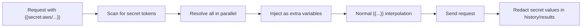

# Secret Providers (`{{secret:alias/path}}`)

HTTP Forge can pull secrets directly from external secret managers at request time using the
`{{secret:alias/path}}` token. The secret value is **never stored** in HTTP Forge config,
history, or result files — the provider fetches it on demand using your ambient credentials
and the resolved value is [redacted](security.md) before anything is written to disk.

This works identically in the **VS Code extension** and the **`@http-forge/cli`** standalone runner.

> Looking for simpler options? For per-developer secrets that don't need a cloud vault, see
> [OS Keychain secrets](environments-variables.md#os-keychain-secrets-recommended) and
> [Local secrets](environments-variables.md#local-secrets) in the Environments guide.

---

## Supported providers

| Alias (default) | Provider | Token syntax | Authentication source | SDK required |
|---|---|---|---|---|
| `aws` | AWS Secrets Manager | `{{secret:aws/<secretId>[#jsonField]}}` | SDK default chain (env, `~/.aws`, IAM role, ECS) | `@aws-sdk/client-secrets-manager` |
| `azure` | Azure Key Vault | `{{secret:azure/<name>[/<version>]}}` | `DefaultAzureCredential` (env, managed identity, CLI) | `@azure/keyvault-secrets`, `@azure/identity` |
| `gcp` | Google Secret Manager | `{{secret:gcp/<name>[/versions/<n>]}}` | Application Default Credentials | `@google-cloud/secret-manager` |
| `vault` | HashiCorp Vault (KV v2) | `{{secret:vault/<path>[#field]}}` | `VAULT_TOKEN` + `VAULT_ADDR` | none (built-in `fetch`) |
| `op` | 1Password | `{{secret:op/<item>/<field>}}` | `op` CLI session or `OP_SERVICE_ACCOUNT_TOKEN` | none (CLI) / optional `@1password/sdk` |
| `doppler` | Doppler | `{{secret:doppler/<NAME>}}` | `DOPPLER_TOKEN` service token | none (built-in `https`) |

All six built-in aliases are **pre-registered out of the box** — you can use
`{{secret:aws/...}}` etc. with zero configuration as long as the matching
credentials/environment variables are present. See [Zero-config defaults](#zero-config-defaults).

Not on the list? Register a workspace resolver module with the
[custom provider](#custom-providers) type.

> **First time using a provider?** The credentials column shows the mechanism; the
> [authentication walkthroughs](#authenticating-http-forge) give the actual sign-in commands,
> verification steps, and minimum permissions for each provider.

---

## How it works

1. Before a request runs, `RequestPreparer` scans the whole request (URL, headers, query, body,
   auth) for `{{secret:alias/path}}` tokens.
2. All distinct tokens are resolved **in parallel**, _before_ normal `{{variable}}` interpolation.
3. Each resolved value is injected as an extra variable, so the normal (synchronous) template
   engine substitutes it transparently — exactly like any other `{{...}}` token.
4. Values are **cached for the lifetime of a single request** so the same secret isn't fetched twice.
5. If a token's alias isn't configured, or the provider call fails, a warning is logged and the
   token is **left as-is** in the output (visible in history as an unresolved template). The
   request is not aborted.



**No credentials are ever stored in HTTP Forge config.** Each provider uses its own
ambient credential chain (env vars, cloud identity, CLI session). The `secrets` block only
holds non-sensitive routing info such as region, vault URL, or project ID.

---

## Authenticating HTTP Forge

HTTP Forge has no sign-in screen and no credential store of its own. It resolves
`{{secret:...}}` tokens from inside the **VS Code extension host** or the **CLI process**, so
each resolver uses that provider's normal authentication mechanism:

- **AWS, Azure, GCP** — the provider SDK's standard credential chain, including credentials
  created by `aws configure`, `az login`, or `gcloud auth application-default login`.
- **Vault, Doppler** — a token read from the process environment (`VAULT_TOKEN`,
  `DOPPLER_TOKEN`).
- **1Password** — a signed-in `op` CLI session or an `OP_SERVICE_ACCOUNT_TOKEN`.
- **Custom** — whatever your module uses. Keep credentials in `process.env` or the provider's
  own SDK/CLI session, not in the `options` block.

The `secrets.providers` block holds routing information (region, vault URL, project ID, custom
options) and, for Doppler, an optional `serviceToken` override. Prefer `DOPPLER_TOKEN` so the
token stays out of config.

Provider SDKs are separate from authentication: AWS, Azure, and GCP need their SDK installed
(see [Installing the provider SDKs](#installing-the-provider-sdks)), while Vault and Doppler
use built-in Node APIs. 1Password uses the `op` CLI or the optional `@1password/sdk`. Custom
providers may use any package installed in `scripts.modulePaths`.

### VS Code: the extension host has its own environment

The extension reads `process.env` of the **VS Code extension host**, not the environment of
an integrated terminal. If you export a token in a terminal and the resolver still says it is
missing:

1. Quit VS Code completely.
2. In the shell where the variable is exported (or where `op signin`/`vault login` succeeded),
   run `code .` to launch VS Code with that environment.
3. Or set the variable at the OS/user-session level and restart VS Code.

Credential **files** and OS keychains/CLI caches are read directly by the provider, so they do
not need to be exported: `~/.aws/*`, the Azure CLI token cache, Application Default
Credentials, and the 1Password desktop integration all work as long as the tool that created
them ran as the same OS user as VS Code. The CLI inherits its shell, so
`VAULT_TOKEN=... http-forge run-suite ...` works as expected.

The extension also needs any CLI it shells out to on the extension host's `PATH` — notably
`az` for Azure and `op` for 1Password. If a terminal can find them but the extension cannot,
launch VS Code from that shell or fix the GUI session's `PATH`.

### Sign-in quick reference

| Provider | Local sign-in | What HTTP Forge reads | Minimum permission |
|---|---|---|---|
| AWS Secrets Manager | `aws configure`, or `aws configure sso` + `aws sso login --profile <profile>` | SDK credential chain + `AWS_REGION` / `AWS_DEFAULT_REGION` | `secretsmanager:GetSecretValue`; `kms:Decrypt` for a customer-managed key |
| Azure Key Vault | `az login` | `DefaultAzureCredential` + `AZURE_KEYVAULT_URL` | `Key Vault Secrets User` role, or secret `Get` access policy |
| Google Secret Manager | `gcloud auth application-default login` | Application Default Credentials + `GOOGLE_CLOUD_PROJECT` / `GCLOUD_PROJECT` / `GCP_PROJECT` | `roles/secretmanager.secretAccessor` |
| HashiCorp Vault | `vault login ...`, then export `VAULT_TOKEN` | `VAULT_TOKEN` + `VAULT_ADDR` + `VAULT_NAMESPACE` | `read` on the KV v2 data path |
| 1Password | `op signin`, or set `OP_SERVICE_ACCOUNT_TOKEN` | `op` CLI session or service-account token | read access to the vault/item |
| Doppler | create a service token, then export `DOPPLER_TOKEN` | `DOPPLER_TOKEN` or `serviceToken` | service token scoped to the project/config |

### AWS Secrets Manager sign-in

```bash
# Interactive access key
aws configure
# Enter AWS Access Key ID, AWS Secret Access Key, default region, and output format.

# Verify with the same credential chain the SDK uses
aws secretsmanager get-secret-value \
  --secret-id myapp/prod \
  --query SecretString \
  --output text
```

For an organization using IAM Identity Center, configure and use an SSO profile instead:

```bash
aws configure sso
aws sso login --profile my-profile
export AWS_PROFILE=my-profile

aws sts get-caller-identity --profile my-profile
```

- The SDK also reads `AWS_ACCESS_KEY_ID`, `AWS_SECRET_ACCESS_KEY`, `AWS_SESSION_TOKEN`,
  `AWS_PROFILE`, and `AWS_REGION` / `AWS_DEFAULT_REGION`.
- For `aws sso login`, make sure `AWS_PROFILE` is visible to the VS Code extension host.
- On EC2, ECS, or Lambda, use the instance/task/execution role; there is nothing to sign in to
  locally.
- If the secret uses a customer-managed KMS key, the identity also needs `kms:Decrypt`.
- In CI, prefer OIDC role assumption over long-lived access keys (see [CI/CD](#cicd)).

### Azure Key Vault sign-in

```bash
# Interactive; add --tenant when your account spans multiple tenants
az login
# az login --tenant <tenant-id>

# Select the subscription that owns the vault
az account set --subscription "<subscription-id-or-name>"

# Verify
az keyvault secret show \
  --vault-name my-vault \
  --name oauth-client-secret \
  --query value -o tsv
```

- `DefaultAzureCredential` picks up the Azure CLI session, so no `AZURE_*` variables are
  needed for interactive use. The `az` CLI must be on the extension host's `PATH`.
- For a service principal in CI, expose the standard environment variables:
  `AZURE_TENANT_ID`, `AZURE_CLIENT_ID`, and `AZURE_CLIENT_SECRET`.
- For Azure-hosted workloads, use a managed identity instead of a secret.
- Set `vaultUrl` or `AZURE_KEYVAULT_URL` to `https://<vault-name>.vault.azure.net`.
- Grant the identity the **Key Vault Secrets User** RBAC role on the vault, or use a vault
  access policy with the secret `Get` permission.

### Google Secret Manager sign-in

```bash
gcloud auth application-default login
gcloud config set project my-project-123

# Verify
gcloud secrets versions access latest \
  --secret="oauth-client-secret" \
  --project="my-project-123"
```

- Use `gcloud auth application-default login`, not just `gcloud auth login`. The latter
  authenticates the CLI but does not create the Application Default Credentials the SDK reads.
- For a service account, either point `GOOGLE_APPLICATION_CREDENTIALS` at the key file, or
  impersonate the account:
  ```bash
  gcloud auth application-default login \
    --impersonate-service-account="forge-reader@my-project-123.iam.gserviceaccount.com"
  ```
- Grant `roles/secretmanager.secretAccessor` on the secret or project.
- `projectId` falls back to `GOOGLE_CLOUD_PROJECT` → `GCLOUD_PROJECT` → `GCP_PROJECT`.
- In CI, prefer Workload Identity Federation over service-account key files.

### HashiCorp Vault sign-in

```bash
export VAULT_ADDR="https://vault.corp.com"
# For HCP Vault Dedicated or Vault Enterprise namespaces:
# export VAULT_NAMESPACE="admin"

# Interactive OIDC (or -method=userpass / -method=ldap)
vault login -method=oidc

# HTTP Forge reads VAULT_TOKEN, not ~/.vault-token
export VAULT_TOKEN="$(vault print token)"

# Verify with the same token
vault kv get secret/myapp/prod
```

- `vault login` normally caches the token in the CLI token helper (by default
  `~/.vault-token`). **HTTP Forge does not read the helper or that file** — it only reads
  `VAULT_TOKEN`. Export it after login, and make sure the export is visible to the VS Code
  extension host.
- To put the token in the environment in one step without using the token helper:
  ```bash
  export VAULT_TOKEN="$(vault login -token-only -method=userpass username=alice)"
  ```
- `address` falls back to `VAULT_ADDR`; `mountPath` defaults to `secret`; `namespace` falls
  back to `VAULT_NAMESPACE`.
- The token policy needs `read` on `<mount>/data/<path>` (for example, `secret/data/myapp/prod`).
- In CI, inject a short-lived token from the CI secret store, or authenticate with AppRole
  before running the CLI.

### 1Password sign-in

```bash
# Interactive: enable the desktop app integration first:
# 1Password app -> Settings -> Developer -> Integrate with 1Password CLI
op signin
op whoami

# Verify a field
op item get "My App" --vault "Private" --fields label=password --reveal
```

- `op signin` is idempotent and uses Touch ID, Windows Hello, or system authentication when
  the desktop app integration is enabled.
- HTTP Forge runs `op` as a child process with the extension host environment. If you use
  `eval $(op signin)` in a shell, launch VS Code from that shell; otherwise use the desktop
  integration so the CLI can authenticate without an exported session token.
- For a service account (recommended for CI):
  ```bash
  export OP_SERVICE_ACCOUNT_TOKEN="ops_..."
  ```
  Create a service account with read access to the vault(s) HTTP Forge needs, then create a
  token. With `@1password/sdk` installed in `scripts.modulePaths`, HTTP Forge uses the SDK;
  without it, it falls back to the `op` CLI, which also accepts `OP_SERVICE_ACCOUNT_TOKEN`.
- `vault` in config is a default vault, not a credential. With it set, use
  `{{secret:op/<item>/<field>}}`; without it, use `{{secret:op/<vault>/<item>/<field>}}`.
- The item and field must be readable by the signed-in user or service account.

### Doppler sign-in

```bash
# In Doppler: Project -> Access -> Service Tokens -> Generate
# Scope the token to the config/environment HTTP Forge should read.
export DOPPLER_TOKEN="dp.st...."

# Verify
curl -sS -H "Authorization: Bearer $DOPPLER_TOKEN" \
  "https://api.doppler.com/v3/configs/config/secret?name=API_KEY"
```

- HTTP Forge does **not** use `doppler login`. That authenticates the Doppler CLI; the resolver
  calls the Doppler REST API with a service token.
- The service token is scoped to a project and config, so the same token reads only that
  environment. Prefer `DOPPLER_TOKEN`; `serviceToken` in the alias config is available for
  per-alias overrides but puts the token in config.
- Secret names are upper-cased automatically: `{{secret:doppler/api_key}}` → `API_KEY`.
- In CI, store the service token as a masked secret and expose it as `DOPPLER_TOKEN`.

---

## Installing the provider SDKs

Three providers (Vault, Doppler, 1Password-via-CLI) need **no npm package**. The cloud SDKs
(AWS, Azure, GCP) are **not bundled** with the extension to keep it slim — they're loaded
on demand from your project.

### In the CLI (`@http-forge/cli`)

The SDKs are declared as `optionalDependencies`, so install only the ones you use:

```bash
npm install @aws-sdk/client-secrets-manager      # AWS
npm install @azure/keyvault-secrets @azure/identity   # Azure
npm install @google-cloud/secret-manager         # GCP
npm install @1password/sdk                       # 1Password Service Account
```

### In the VS Code extension

The extension loads SDKs from your **project's** `node_modules`, resolved through the first
`scripts.modulePaths` entry that contains a `package.json`. Install the SDK there:

```jsonc
// .http-forge/http-forge.config.json
{
  "scripts": { "modulePaths": ["./.http-forge/assets/lib"] }
}
```

```bash
cd .http-forge/assets/lib
npm install @aws-sdk/client-secrets-manager
```

If an SDK is missing, the resolver throws a clear message telling you exactly which package to install.

---

## Configuration

Add a `secrets.providers` block to `.http-forge/http-forge.config.json`. The **key** is the alias used in
the token (`{{secret:<alias>/...}}`); the `provider` field selects the implementation.

```json
{
  "secrets": {
    "providers": {
      "aws":     { "provider": "aws",       "region": "us-east-1" },
      "azure":   { "provider": "azure",     "vaultUrl": "https://my-vault.vault.azure.net" },
      "gcp":     { "provider": "gcp",       "projectId": "my-project-123" },
      "vault":   { "provider": "vault",     "address": "https://vault.corp.com", "mountPath": "secret", "namespace": "admin" },
      "op":      { "provider": "1password", "vault": "Private" },
      "doppler": { "provider": "doppler" }
    }
  }
}
```

Alias and provider type are independent — you can register the **same provider under multiple
aliases** with different settings:

```json
{
  "secrets": {
    "providers": {
      "aws-us": { "provider": "aws", "region": "us-east-1" },
      "aws-eu": { "provider": "aws", "region": "eu-west-1" }
    }
  }
}
```

Then `{{secret:aws-eu/myapp/token}}` reads from `eu-west-1`.

### Merge & precedence

Your `secrets.providers` are deep-merged over the [zero-config defaults](#zero-config-defaults)
**per alias**. Defining an alias replaces that alias's default entry entirely; aliases you don't
touch keep their defaults. Within a provider, any field you omit falls back to its environment
variable (see each provider below), following this precedence:

> user config → default config → environment variable → built-in default / fail

---

## Provider setup

### AWS Secrets Manager

```json
{ "aws": { "provider": "aws", "region": "us-east-1" } }
```

- **Credentials:** AWS SDK v3 default chain — env vars → `~/.aws/credentials` / `~/.aws/config`
  profiles (including SSO) → IAM instance role → ECS task role. See
  [AWS Secrets Manager sign-in](#aws-secrets-manager-sign-in).
- **`region`** falls back to `AWS_DEFAULT_REGION` → `AWS_REGION`.
- **Token:** `{{secret:aws/<secretId>}}` returns the raw `SecretString`.
- **JSON field:** for a JSON secret, append `#field` → `{{secret:aws/myapp/prod#db_password}}`.

### Azure Key Vault

```json
{ "azure": { "provider": "azure", "vaultUrl": "https://my-vault.vault.azure.net" } }
```

- **Credentials:** `DefaultAzureCredential` — env vars → managed identity → Azure CLI (via
  `az login`) → Azure PowerShell → Azure Developer CLI. The `az` CLI must be on the extension
  host's `PATH`. See [Azure Key Vault sign-in](#azure-key-vault-sign-in).
- **`vaultUrl`** falls back to `AZURE_KEYVAULT_URL` (an empty/omitted value triggers the fallback).
- **Token:** `{{secret:azure/<secretName>}}`, or pin a version with `{{secret:azure/<secretName>/<version>}}`.

### Google Secret Manager

```json
{ "gcp": { "provider": "gcp", "projectId": "my-project-123" } }
```

- **Credentials:** Application Default Credentials — `GOOGLE_APPLICATION_CREDENTIALS` →
  `gcloud auth application-default login` → Workload Identity → metadata server. See
  [Google Secret Manager sign-in](#google-secret-manager-sign-in).
- **`projectId`** falls back to `GOOGLE_CLOUD_PROJECT` → `GCLOUD_PROJECT` → `GCP_PROJECT`.
- **Token:** `{{secret:gcp/<secretName>}}` (latest), or `{{secret:gcp/<secretName>/versions/3}}` for a specific version.

### HashiCorp Vault (KV v2)

```json
{ "vault": { "provider": "vault", "address": "https://vault.corp.com", "mountPath": "secret", "namespace": "admin" } }
```

- **No SDK needed** — uses built-in `fetch` against the KV v2 API (`/v1/<mountPath>/data/<path>`).
- **Credentials:** `VAULT_TOKEN` (required). **HTTP Forge reads `VAULT_TOKEN`, not
  `~/.vault-token`** — after `vault login`, export the token with
  `export VAULT_TOKEN="$(vault print token)"`. See
  [HashiCorp Vault sign-in](#hashicorp-vault-sign-in). **`address`** falls back to `VAULT_ADDR`
  (default `http://127.0.0.1:8200`).
- **`mountPath`** defaults to `secret`. **`namespace`** (Enterprise/HCP) is sent as `X-Vault-Namespace` and falls back to `VAULT_NAMESPACE`.
- **Token:** `{{secret:vault/<path>}}` returns the `value` key; pin a field with `#field` → `{{secret:vault/myapp/prod#db_password}}`.

### 1Password

```json
{ "op": { "provider": "1password", "vault": "Private" } }
```

- **Credentials:** the `op` CLI signed-in session (`op signin`), or a Service Account via
  `OP_SERVICE_ACCOUNT_TOKEN` (CI). With a service-account token and `@1password/sdk` installed,
  the SDK path is used; otherwise it shells out to `op`. See
  [1Password sign-in](#1password-sign-in).
- **`vault`** sets a default vault so tokens can omit it: with it → `{{secret:op/<item>/<field>}}`; without it → `{{secret:op/<vault>/<item>/<field>}}`.

### Doppler

```json
{ "doppler": { "provider": "doppler" } }
```

- **No SDK needed** — uses built-in `https` against the Doppler REST API.
- **Credentials:** `DOPPLER_TOKEN` service token (project/config are baked into the token).
  Override per-alias with `serviceToken`. **HTTP Forge does not use `doppler login`** — that
  authenticates the Doppler CLI, not this resolver. See
  [Doppler sign-in](#doppler-sign-in).
- **Token:** `{{secret:doppler/<NAME>}}` — the name is upper-cased automatically (`{{secret:doppler/api_key}}` → `API_KEY`).

---

## Custom providers

If your secret store is not one of the built-ins, register a workspace module under the
`custom` provider type. The module is loaded from the first `scripts.modulePaths` entry that
contains a `package.json` — the same location used for optional SDKs and custom script modules.
No extension or CLI rebuild is needed.

### Module contract

The module can export any of:

- a resolver factory function,
- an object with a `createResolver` function,
- a resolver object with a `resolve(path)` method.

A factory receives `{ alias, options }` and returns an object with `providerName` and an async
`resolve(path)` method. `providerName` is used for diagnostics; if omitted, the alias is used.
Return a string on success, `undefined` when the secret does not exist, and throw on
authentication or transport errors. The path after the alias — including any `#field` suffix —
is passed to `resolve(path)` unchanged, so the module decides how to parse it.

```js
// .http-forge/assets/lib/corp-secrets.js
module.exports = function createResolver({ options }) {
    const baseUrl = process.env.CORP_SECRETS_URL;
    const token = process.env.CORP_SECRETS_TOKEN;

    if (!baseUrl || !token) {
        throw new Error('Set CORP_SECRETS_URL and CORP_SECRETS_TOKEN in the HTTP Forge process.');
    }

    const mount = options.mount ?? 'kv';

    return {
        providerName: 'corp',
        async resolve(path) {
            const hash = path.lastIndexOf('#');
            const secretPath = hash >= 0 ? path.slice(0, hash) : path;
            const field = hash >= 0 ? path.slice(hash + 1) : undefined;

            const response = await fetch(`${baseUrl}/v1/${mount}/${secretPath}`, {
                headers: { Authorization: `Bearer ${token}` },
                signal: AbortSignal.timeout(10000),
            });

            if (response.status === 404) return undefined;
            if (!response.ok) throw new Error(`Corp secrets returned HTTP ${response.status}`);

            const body = await response.json();
            return field ? body.data?.[field] : body.data?.value;
        },
    };
};
```

TypeScript modules can import `CustomSecretProviderContext`, `CustomSecretResolver`, and
`CustomSecretResolverFactory` from `@http-forge/core`.

### Configuration

Add the alias to `.http-forge/http-forge.config.json`. `module` may be a relative file in the
module path or an installed package name; `options` is optional and should contain only
non-sensitive routing data. The module must be loadable by Node's `require` (compile TypeScript
before using it).

```jsonc
{
  "scripts": { "modulePaths": ["./.http-forge/assets/lib"] },
  "secrets": {
    "providers": {
      "corp": {
        "provider": "custom",
        "module": "./corp-secrets.js",
        "options": { "mount": "kv" }
      }
    }
  }
}
```

Use it anywhere a secret token is allowed:

```http
Authorization: Bearer {{secret:corp/myapp/prod#apiKey}}
```

For a team, publish the resolver as an npm package and install it in
`.http-forge/assets/lib`:

```jsonc
{
  "scripts": { "modulePaths": ["./.http-forge/assets/lib"] },
  "secrets": {
    "providers": {
      "corp": {
        "provider": "custom",
        "module": "@acme/http-forge-secret-provider"
      }
    }
  }
}
```

### Custom provider rules

- **Trusted code only.** The module runs with the same Node privileges as HTTP Forge. Only load
  workspace code you trust; there is no sandbox.
- **Keep credentials out of config.** Use `process.env` or the provider's own SDK/CLI session.
- **Do not log resolved values.** Core redacts values that pass through history/results, but
  `console.log` inside the module is outside that path.
- **Synchronous factory.** The factory must return the resolver synchronously. `resolve(path)`
  can be async.
- **Reload after module changes.** The registry rebuilds when `secrets` or `modulePaths` change;
  after editing the module file itself, reload the VS Code window or restart the CLI.
- **Failures are non-fatal.** A load or resolve failure logs a warning and leaves the token
  unresolved; the request is not aborted.

---

## Zero-config defaults

Even with **no `secrets` block**, all six built-in aliases are pre-registered with minimal
settings, so they work as soon as the matching credentials/env vars are present:

| Alias | Reads from |
|---|---|
| `aws` | `AWS_REGION` + SDK credential chain |
| `azure` | `AZURE_KEYVAULT_URL` + `DefaultAzureCredential` |
| `gcp` | `GOOGLE_CLOUD_PROJECT` + Application Default Credentials |
| `vault` | `VAULT_ADDR` + `VAULT_TOKEN` |
| `op` | `op` CLI session or `OP_SERVICE_ACCOUNT_TOKEN` |
| `doppler` | `DOPPLER_TOKEN` |

Add a `secrets` block only when you need to pin a region/URL/project or register extra aliases.
Custom provider aliases are never pre-registered; define them explicitly as shown in
[Custom providers](#custom-providers).

---

## Usage in requests

Use a secret token anywhere a `{{variable}}` is allowed — URL, headers, query params, or body:

```http
GET {{baseUrl}}/users
Authorization: Bearer {{secret:aws/prod/myapp/api-token}}
X-Tenant-Key: {{secret:vault/myapp/prod#tenantKey}}
X-Vault-Item: {{secret:op/prod-db/password}}
```

```jsonc
// JSON body
{
  "clientSecret": "{{secret:azure/oauth-client-secret}}",
  "dopplerKey": "{{secret:doppler/STRIPE_KEY}}"
}
```

You can mix secret tokens with normal variables and filters freely.

---

## CLI usage

The same tokens resolve in `@http-forge/cli`. Make sure the required env vars/credentials and any
needed SDKs are available in the shell that runs the CLI:

```bash
# AWS — SDK installed + credentials in env / IAM role
AWS_REGION=us-east-1 npx @http-forge/cli run-suite smoke --env prod

# Vault — no SDK needed
VAULT_ADDR=https://vault.corp.com VAULT_TOKEN=$VAULT_TOKEN \
  npx @http-forge/cli run-suite smoke --env prod

# Doppler — no SDK needed
DOPPLER_TOKEN=$DOPPLER_TOKEN npx @http-forge/cli run-suite smoke --env prod

# Custom provider — module installed under scripts.modulePaths
CORP_SECRETS_URL=https://secrets.corp.example CORP_SECRETS_TOKEN=$CORP_SECRETS_TOKEN \
  npx @http-forge/cli run-suite smoke --env prod
```

---

## CI/CD

No resolved secret values are stored in HTTP Forge config, so pipelines just need to expose the
provider's own credentials to the environment:

```yaml
# GitHub Actions — AWS via OIDC role, no secrets in config
- uses: aws-actions/configure-aws-credentials@v4
  with:
    role-to-assume: ${{ secrets.AWS_ROLE_ARN }}
    aws-region: us-east-1
- run: |
    npm install @aws-sdk/client-secrets-manager
    npx @http-forge/cli run-suite smoke --env prod
```

```yaml
# HashiCorp Vault — token from the CI secret store
- env:
    VAULT_ADDR: https://vault.corp.com
    VAULT_TOKEN: ${{ secrets.VAULT_TOKEN }}
  run: npx @http-forge/cli run-suite smoke --env prod
```

---

## Security

- Secret values are **never written** to config, history, or result files — they're
  [redacted](security.md) after resolution.
- Provider credentials are read from the environment, cloud identity, or a CLI session. The
  one exception is Doppler's explicit `serviceToken` alias override, which is stored in config;
  prefer `DOPPLER_TOKEN` so the token stays out of the config file.
- A failed or unconfigured token is left unresolved (and logged) rather than silently sending
  an empty value.
- Custom providers are trusted workspace code loaded from `scripts.modulePaths`. They run with
  the same Node privileges as HTTP Forge and their own console output is not covered by HTTP
  Forge redaction; review the module and never log resolved values.

See [Security & Sensitive Data](security.md) for the full redaction model.

---

## Troubleshooting

| Symptom | Likely cause / fix |
|---|---|
| Token appears unresolved in history | Alias not configured, or provider call failed — check the warning logged at run time. |
| `requires @aws-sdk/client-secrets-manager` (or similar) | SDK not installed. Install it in the CLI project or the extension's `modulePaths` folder. |
| Azure: "no vault URL configured" | Set `vaultUrl` or `AZURE_KEYVAULT_URL`. |
| GCP: "no projectId configured" | Set `projectId` or `GOOGLE_CLOUD_PROJECT`. |
| Vault: "requires VAULT_TOKEN" | Export `VAULT_TOKEN` (and `VAULT_ADDR` if not default). `vault login` stores the token in `~/.vault-token`; HTTP Forge does not read that file. |
| 1Password: "requires `op` CLI" | Install the 1Password CLI and run `op signin`, or set `OP_SERVICE_ACCOUNT_TOKEN`. |
| Doppler: "no service token found" | Set `DOPPLER_TOKEN` or add `serviceToken` to the alias config. |
| Works in a terminal but the extension reports missing credentials | The extension host has a different environment and `PATH`. Quit VS Code, then run `code .` from the authenticated shell, or set the variable at the OS level. |
| 1Password works in a terminal but the extension says it is not signed in | The extension host cannot see the shell session or `op` on its `PATH`. Use the desktop app integration or launch VS Code from the signed-in shell. |
| Custom: "could not load module" | Ensure the first `scripts.modulePaths` entry contains a `package.json`, the module file exists relative to that directory (or the package is installed there), and the path in `module` matches. |
| Custom: "must export a resolver factory…" | Export a factory function, an object with `createResolver`, or an object with `resolve(path)`. |
| Custom: token still uses old behavior after editing the module | The module file itself changed, not the config. Reload the VS Code window or restart the CLI. |

See also [Troubleshooting & FAQs](troubleshooting.md).
